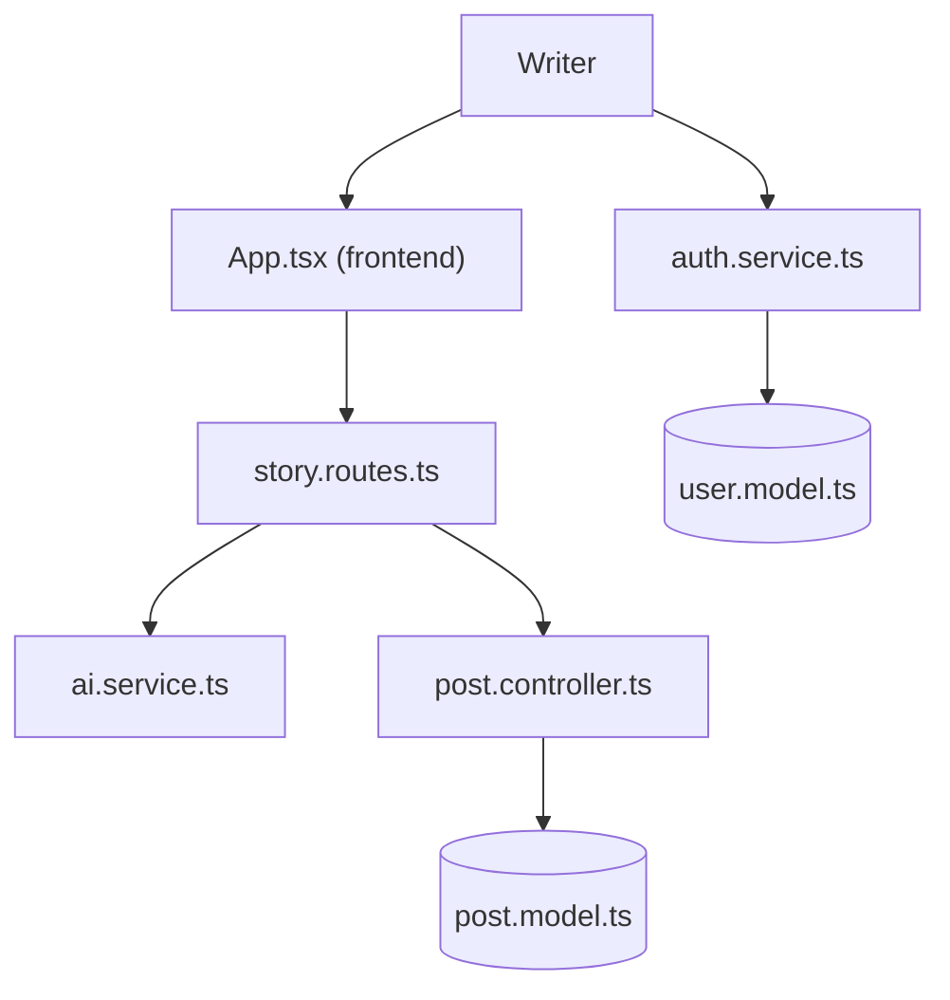

# ronisarkarexe/story-spark-ai

> Web application that generates stories from a prompt, for amateur authors and AI-curious users.

## The problem
Writing a story from a raw idea takes time. The tool proposes several variants of the same prompt and compares them.

## What it actually does
React + Vite frontend and Node/Express API on MongoDB. The prompt goes to OpenAI or Gemini, which returns several variants. Around it: text analysis, favorites, reviews, community posts, subscriptions via Razorpay, Google login. The README notes that multiple clicks on "Generate" create duplicate calls.

## How it is wired


## Trying it
```bash
pnpm install
cd backend
npx ts-node scripts/seed-admin.ts
pnpm dev
```

## Cost and gotchas
You need an OpenAI or Gemini key (billed per call), a MongoDB database and many environment variables. No Socket.IO on Vercel.

## What it is not
It is not a data or MLOps tool: it is a consumer application. Paid features depend on Razorpay. No deduplication of in-flight requests.

## Alternatives
No alternative named in the README.

## For you
Ignore: it is a text-generation product built around API calls, with no reusable component for a data, AI or MLOps profile.
