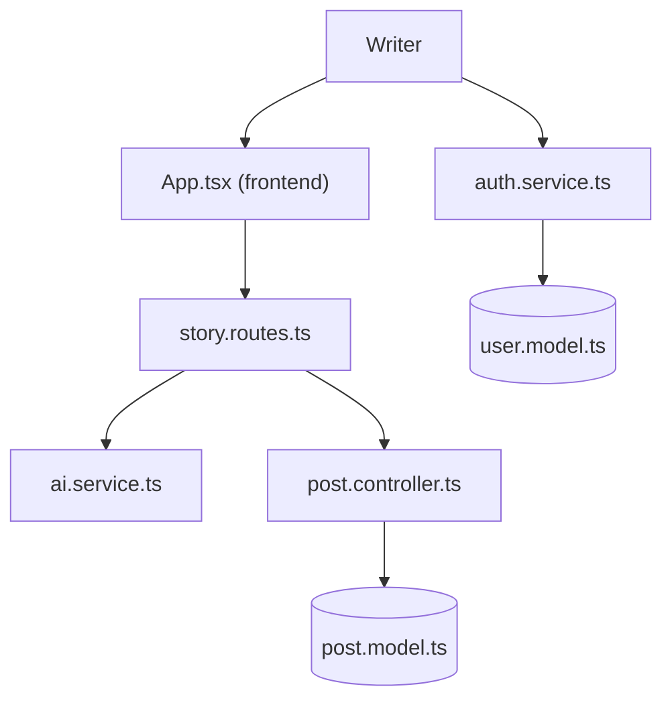

# ronisarkarexe/story-spark-ai

> Application web qui génère des histoires à partir d'un prompt, pour auteurs amateurs et curieux d'IA.

## Le problème
Écrire une histoire à partir d'une idée brute demande du temps. L'outil propose plusieurs variantes d'un même prompt et les compare.

## Ce que ça fait vraiment
Frontend React + Vite et API Node/Express sur MongoDB. Le prompt part vers OpenAI ou Gemini, qui renvoie plusieurs variantes. Autour : analyse de texte, favoris, avis, posts communautaires, abonnements via Razorpay, connexion Google. Le README signale que les clics multiples sur « Generate » créent des appels en double.

## Comment c'est branché


## Essayer
```bash
pnpm install
cd backend
npx ts-node scripts/seed-admin.ts
pnpm dev
```

## Coût et pièges
Il faut une clé OpenAI ou Gemini (facturée à l'appel), une base MongoDB et de nombreuses variables d'environnement. Pas de Socket.IO sur Vercel.

## Ce que ce n'est pas
Ce n'est pas un outil de data ou de MLOps : c'est une application grand public. Les fonctions payantes dépendent de Razorpay. Aucun dédoublonnage des requêtes en vol.

## Alternatives
Aucune alternative nommée dans le README.

## Pour toi
À ignorer : c'est un produit de génération de texte autour d'appels d'API, sans brique réutilisable pour un profil data, IA ou MLOps.

