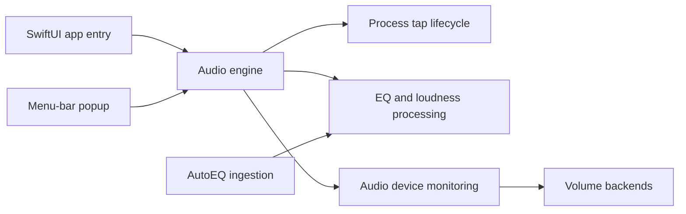

# ronitsingh10/FineTune

> macOS menu-bar application that adjusts volume, routing and equalizer per application.

## The problem
macOS offers neither per-application volume, nor routing an app to a specific output, nor a system equalizer.

## What it actually does
SwiftUI application that places Core Audio "process taps" per process: volume and boost up to 4x, routing to one or more devices, 10-band EQ, AutoEQ headphone correction, ISO 226 loudness compensation. Handles device priorities, monitor DDC, Bluetooth, global shortcuts, media keys and URL schemes for automation.

## How it is wired


## Trying it
```bash
brew install --cask finetune
git clone https://github.com/ronitsingh10/FineTune.git
cd FineTune
open FineTune.xcodeproj
```

## Cost and gotchas
Free; macOS 15 minimum and the "Screen & System Audio Recording" permission is mandatory. 208 open issues for a single author.

## What it is not
Nothing to do with model fine-tuning despite the name: it is an audio utility. No Windows or Linux version.

## Alternatives
No alternative named in the README.

## For you
Ignore for data/AI watch: the name is confusing but it is a macOS audio utility, useful only as a personal tool on your Mac.
