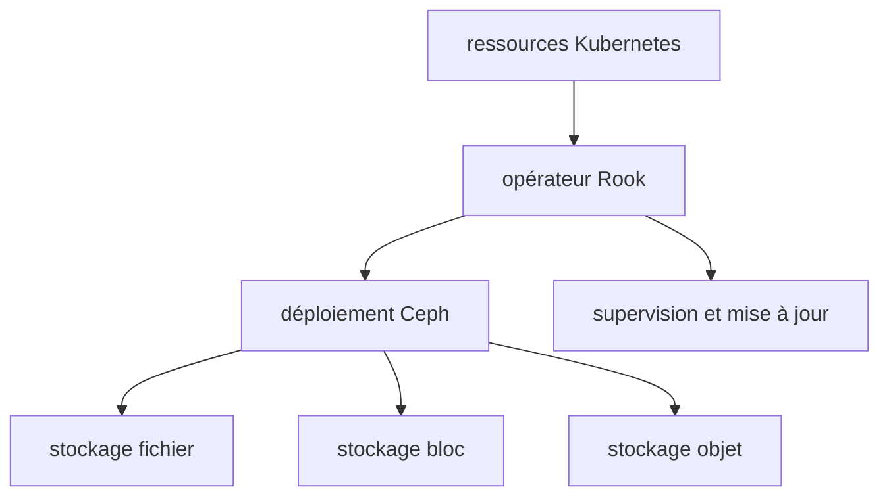

# rook/rook

> Cloud-native storage orchestrator that integrates Ceph natively with Kubernetes.

## The problem
Deploying and operating a Ceph cluster by hand under Kubernetes is a heavy administration burden
and easy to get wrong.

## What it actually does
Rook automates the deployment and management of Ceph to provide self-managing,
self-scaling and self-healing storage. The operator relies on Kubernetes resources to
deploy, configure, provision, scale, update and monitor Ceph, which
provides file, block and object storage. The status of the Ceph provider is **Stable**, with
backward compatibility ensured between versions.

## How it is wired

## Trying it
No command is documented in the README: it points to the documentation and the QuickStart
Guide for installation, deployment and administration.

## Cost and gotchas
Free, Apache 2.0 license. A Kubernetes cluster and the associated disk capacity are required. The README
strongly recommends using only official releases: builds from `master`
may change or lose features at any time, without notice or support.

## What it is not
It is not a storage system: it is the orchestrator that drives Ceph. Nor is it a multi-backend
product according to this README, which only describes the Ceph provider. The README is
short and defers everything concrete to the external documentation.

## Alternatives
No alternative is named in the README.

## For you
Worth knowing if your data platform runs on self-hosted Kubernetes and you need persistent
storage; outside that case, it is the infra team's turf.
