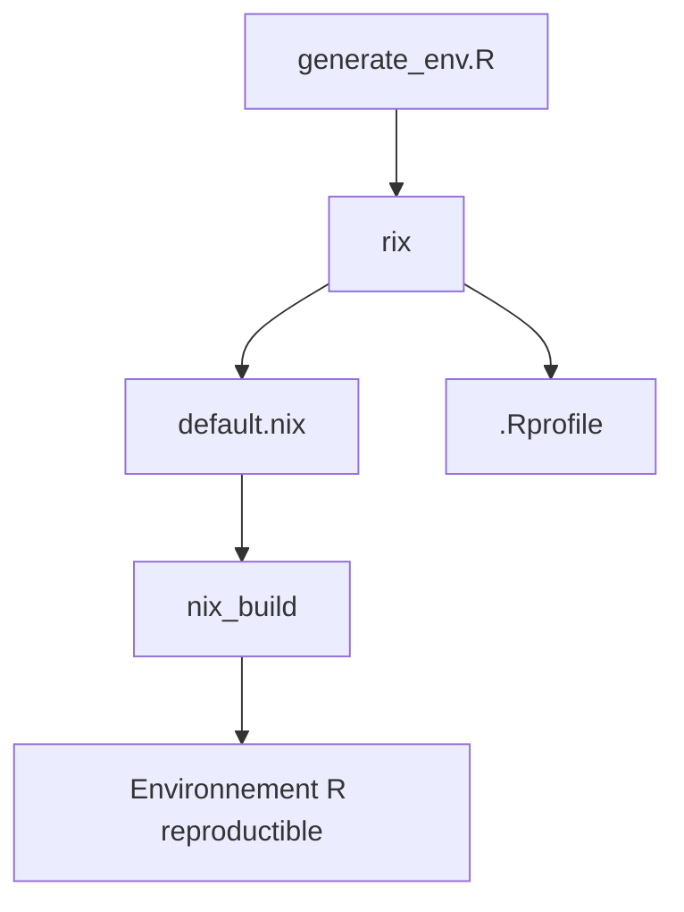

# ropensci/rix

> R package that generates reproducible environments with Nix, R, Python and Julia, for research and pipelines.

## The problem
renv pins R package versions but not system dependencies (GDAL, etc.), so analyses are not reproducible.

## What it actually does
`rix()` writes a `default.nix` and a `.Rprofile` from an R version or a date, R packages, and optionally Python or Julia. It can start from a `renv.lock`, be used with RStudio, VS Code or in continuous integration, and produce Docker images. Almost all CRAN and Bioconductor packages are available; fewer than 5% are not.

## How it is wired
Simplified diagram based on the sheet, no diagram provided.



## Trying it
```bash
nix-shell -p R rPackages.rix
Rscript generate_env.R
```
```r
install.packages("rix")
library("rix")
rix(r_ver = "4.3.3", r_pkgs = c("dplyr", "ggplot2"), project_path = ".", overwrite = TRUE)
nix_build(project_path = ".")
```

## Cost and gotchas
Nix must be installed (Determinate Systems installer), with WSL on Windows. Steep learning curve. Python and Julia support is not guaranteed. GPL-3.0.

## What it is not
Not a replacement for Docker for everything. Not a complete polyglot tool: the README points to other tools for that.

## Alternatives
- rixpress: little sibling for polyglot pipelines, inspired by targets.
- renv + Docker, Conda, Guix: compared in the README.

## For you
Adopt if you do R or reproducible pipelines: the reproducibility gain is real, but plan time to learn Nix.
