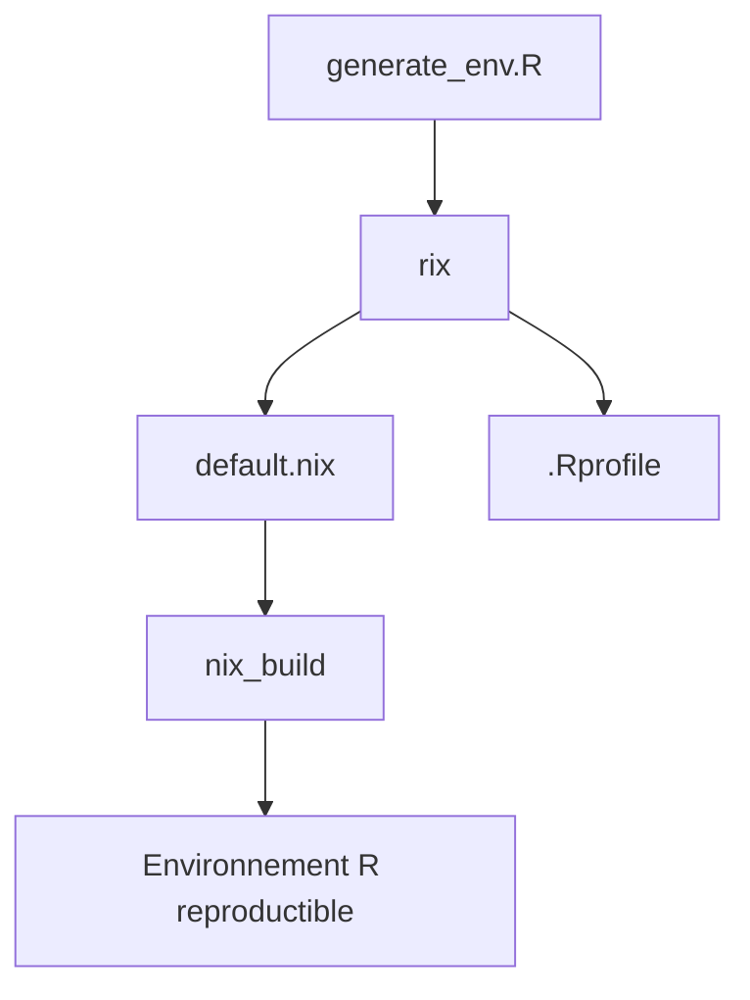

# ropensci/rix

> Paquet R qui génère des environnements reproductibles avec Nix, R, Python et Julia, pour la recherche et les pipelines.

## Le problème
renv fige les versions de paquets R mais pas les dépendances système (GDAL, etc.), donc les analyses ne se reproduisent pas.

## Ce que ça fait vraiment
`rix()` écrit un `default.nix` et un `.Rprofile` à partir d'une version de R ou d'une date, de paquets R, et de Python ou Julia en option. Il peut partir d'un `renv.lock`, s'utiliser avec RStudio, VS Code ou en intégration continue, et produire des images Docker. Presque tous les paquets CRAN et Bioconductor sont disponibles ; moins de 5 % ne le sont pas.

## Comment c'est branché
Schéma simplifié d'après la fiche, sans diagramme fourni.



## Essayer
```bash
nix-shell -p R rPackages.rix
Rscript generate_env.R
```
```r
install.packages("rix")
library("rix")
rix(r_ver = "4.3.3", r_pkgs = c("dplyr", "ggplot2"), project_path = ".", overwrite = TRUE)
nix_build(project_path = ".")
```

## Coût et pièges
Nix à installer (installateur Determinate Systems), avec WSL sous Windows. Courbe d'apprentissage raide. Le support de Python et Julia n'est pas garanti. GPL-3.0.

## Ce que ce n'est pas
Pas un remplaçant de Docker pour tout. Pas un outil polyglotte complet : le README renvoie vers d'autres outils pour cela.

## Alternatives
- rixpress : petit frère pour des pipelines polyglottes, inspiré de targets.
- renv + Docker, Conda, Guix : comparés dans le README.

## Pour toi
À adopter si tu fais du R ou des pipelines reproductibles : le gain de reproductibilité est réel, mais prévois du temps pour apprendre Nix.

