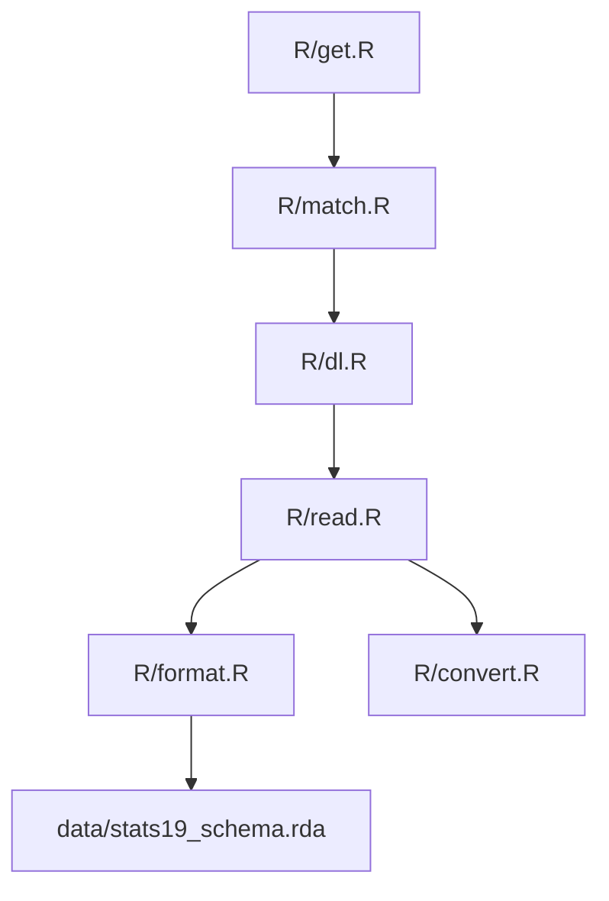

# ropensci/stats19

> R package to download and format the official British road accident data, STATS19.

## The problem
The Department for Transport CSV files have to be found, read and labelled by hand, with frequent errors.

## What it actually does
`get_stats19()` looks up the file by year and type (collisions, casualties, vehicles), downloads it, reads it and applies the variable schema. Data goes back to 1979. DuckDB and Parquet engines speed up work on the full series (about 1.5 GB of CSV), and `format_sf()` produces geographic objects.

## How it is wired


## Trying it
```bash
Rscript -e 'remotes::install_github("ropensci/stats19")'
```
```r
library(stats19)
crashes = get_stats19(year = 2023, type = "collision")
```

## Cost and gotchas
Downloading older years is heavy (a file of about 1 GB) and formatting takes time. Files go to a temporary folder unless `STATS19_DOWNLOAD_DIRECTORY` is set; Parquet caches do not rebuild themselves.

## What it is not
Not a hosted dataset: it downloads from the British government website. The data covers Great Britain only.

## Alternatives
No alternative named in the README (the package cites stplanr for older functions).

## For you
Worth watching: a good example of a reproducible open-data pipeline in R, useful if you work on geographic data or road safety; otherwise off topic.
