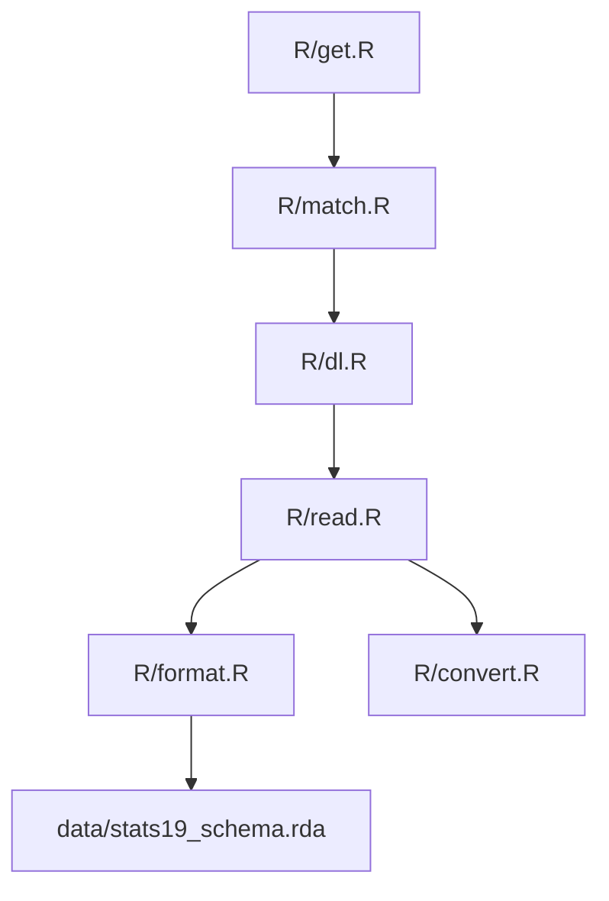

# ropensci/stats19

> Paquet R pour télécharger et formater les données officielles d'accidents de la route britanniques STATS19.

## Le problème
Les fichiers CSV du ministère des Transports sont à trouver, lire et étiqueter à la main, avec des erreurs fréquentes.

## Ce que ça fait vraiment
`get_stats19()` cherche le fichier par année et type (collisions, victimes, véhicules), le télécharge, le lit et applique le schéma des variables. Les données remontent à 1979. Des moteurs DuckDB et Parquet accélèrent le travail sur la série complète (environ 1,5 Go de CSV), et `format_sf()` produit des objets géographiques.

## Comment c'est branché


## Essayer
```bash
Rscript -e 'remotes::install_github("ropensci/stats19")'
```
```r
library(stats19)
crashes = get_stats19(year = 2023, type = "collision")
```

## Coût et pièges
Le téléchargement des années anciennes est lourd (fichier d'environ 1 Go) et le formatage prend du temps. Les fichiers vont dans un dossier temporaire sauf si `STATS19_DOWNLOAD_DIRECTORY` est défini ; les caches Parquet ne se reconstruisent pas seuls.

## Ce que ce n'est pas
Pas un jeu de données hébergé : il télécharge depuis le site du gouvernement britannique. Les données couvrent la Grande-Bretagne uniquement.

## Alternatives
Aucune alternative nommée dans le README (le paquet cite stplanr pour d'anciennes fonctions).

## Pour toi
À surveiller : bon exemple de pipeline de données ouvertes reproductible en R, utile si tu fais de la donnée géographique ou de la sécurité routière ; sinon hors sujet.

