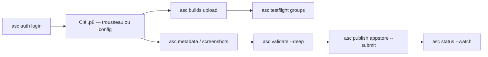

# rorkai/App-Store-Connect-CLI

> Scriptable Go CLI to drive the App Store Connect API from a terminal or a CI.

## The problem
Publishing an Apple app goes through a multi-step web interface that is hard to script, to replay in CI and to check before submission.

## What it actually does
Covers the full cycle: API key authentication (with or without keychain), upload of `.ipa` or `.pkg` builds, TestFlight groups, feedback and crashes, metadata and localizations, screenshots per device and per language, signing and profiles, bundle IDs, Xcode Cloud workflows, Apple Ads campaigns and StoreKit retention messages. `asc validate` checks a version's readiness and flags template leftovers (`Lorem ipsum`, `TODO`, `TBD`). The output format adapts: table in a terminal, JSON in a pipe or in CI.

## How it is wired


## Trying it
```bash
brew install asc
curl -fsSL https://asccli.sh/install | bash
asc auth login --name "MyApp" --key-id "ABC123" --issuer-id "DEF456" --private-key /path/to/AuthKey.p8 --network
asc auth doctor
asc apps list --output table
asc publish appstore --app "123456789" --ipa "/path/to/MyApp.ipa" --version "1.2.3" --submit --confirm
asc telemetry disable
```

## Cost and gotchas
Free, standalone binaries with no Go required. **Telemetry enabled by default**: version, OS, command path, duration, HTTP code on failure — without raw arguments or credentials, can be disabled with `asc telemetry disable`, `ASC_TELEMETRY_DISABLED=1` or `DO_NOT_TRACK=1`. The `--deep` mode relies on private Apple endpoints that may change without notice: an unexpected response gives `unverified`, not a block. `asc signing fetch` does not retrieve the private key.

## What it is not
It is not a build tool: it orchestrates Xcode, it does not replace it. It is not an Apple product. The WinGet package is not yet accepted.

## Alternatives
- **app-store-connect-cli-skills**: the companion pack of 25 agent skills, installed by `asc install-skills`.

## For you
Not applicable outside iOS/macOS development.
