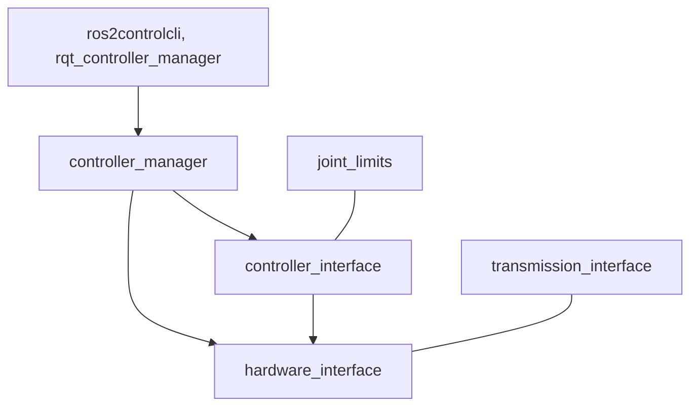

# ros-controls/ros2_control

> Hardware control framework for ROS 2 robots: controller manager and hardware interfaces.

## The problem
Every robot exposes its sensors and actuators in its own way, which makes controllers hard to reuse.

## What it actually does
The README contains almost only build badges and a mention of Docker images. Judging from the code architecture, a Controller Manager loads and orchestrates the controllers, which exchange with the Hardware Interface. Joint Limits and Transmission Interface enforce the limits and mechanical couplings, with a CLI and an rqt interface.

## How it is wired

## Trying it
No command in the README; it points to the documentation. Docker images: `ghcr.io/ros-controls/ros2_control_release` and `ghcr.io/ros-controls/ros2_control_source`.

## Cost and gotchas
Free. It needs a ROS 2 environment (Rolling, Kilted, Jazzy or Humble); installation details are undocumented here.

## What it is not
Not an AI or motion-planning tool: it handles the low-level control layer. It is unusable without a robot or a ROS 2 simulator.

## Alternatives
No alternative named in the README.

## For you
Ignore, unless you have a ROS 2 robotics project: otherwise it is outside your data, AI or MLOps scope.
