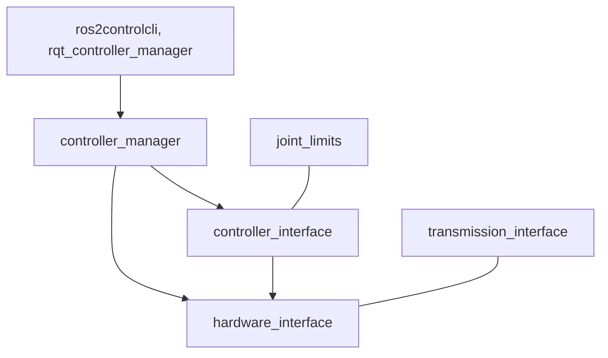

# ros-controls/ros2_control

> Cadre de contrôle matériel pour robots sous ROS 2 : gestionnaire de contrôleurs et interfaces matérielles.

## Le problème
Chaque robot expose ses capteurs et actionneurs à sa façon, ce qui rend les contrôleurs difficiles à réutiliser.

## Ce que ça fait vraiment
Le README ne contient presque que des badges de build et une mention des images Docker. D'après l'architecture du code, un Controller Manager charge et orchestre les contrôleurs, qui échangent avec le Hardware Interface. Joint Limits et Transmission Interface imposent les limites et les liaisons mécaniques, avec une CLI et une interface rqt.

## Comment c'est branché

## Essayer
Aucune commande dans le README ; il renvoie à la documentation. Images Docker : `ghcr.io/ros-controls/ros2_control_release` et `ghcr.io/ros-controls/ros2_control_source`.

## Coût et pièges
Gratuit. Il faut un environnement ROS 2 (Rolling, Kilted, Jazzy ou Humble) ; les détails d'installation sont non documentés ici.

## Ce que ce n'est pas
Pas un outil d'IA ni de planification de mouvement : il s'occupe de la couche de contrôle bas niveau. Il est inutilisable sans robot ou simulateur ROS 2.

## Alternatives
Aucune alternative nommée dans le README.

## Pour toi
À ignorer, sauf projet de robotique sous ROS 2 : sans cela, il est hors de ton périmètre data, IA ou MLOps.

