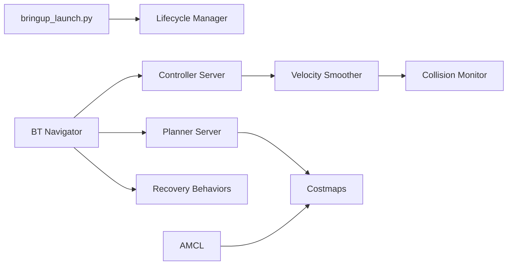

# ros-navigation/navigation2

> ROS 2 navigation stack (Nav2) for mobile robots: planning, control, avoidance.

## The problem
Making a mobile robot navigate autonomously requires localization, maps, planning and failure recovery.

## What it actually does
Multi-package C++ system (ament/CMake) where ROS 2 servers communicate through actions, services, topics and TF. A behavior tree (BT) navigator calls planners (NavFn, Theta*, Smac), controllers (DWB, MPPI, Regulated Pure Pursuit…), smoothers and recovery behaviors. AMCL localization, layered costmaps, collision monitor, docking, following. Plugins declared via pluginlib.

## How it is wired

## Trying it
No command documented in the README: everything is deferred to the documentation site (build, install, Docker).

## Cost and gotchas
Free; requires ROS 2 (humble, jazzy, lyrical) and a robot or simulator. Very sparse README. License not identified by GitHub. Professional services via Open Navigation.

## What it is not
Not a general-purpose AI framework; it is ROS 2 robotics.

## Alternatives
No alternative named in the README.

## For you
Worth watching: relevant only if you do robotics or simulation; otherwise unrelated to your profile.
