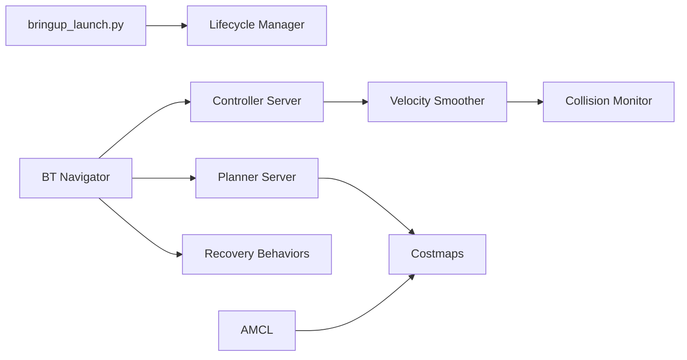

# ros-navigation/navigation2

> Pile de navigation ROS 2 (Nav2) pour robots mobiles : planification, contrôle, évitement.

## Le problème
Faire naviguer un robot mobile de façon autonome demande localisation, cartes, planification et recouvrement d'échecs.

## Ce que ça fait vraiment
Système C++ multi-paquets (ament/CMake) où des serveurs ROS 2 communiquent par actions, services, topics et TF. Un navigateur à arbres de comportement (BT) appelle planners (NavFn, Theta*, Smac), contrôleurs (DWB, MPPI, Regulated Pure Pursuit…), lisseurs et comportements de récupération. Localisation AMCL, costmaps en couches, collision monitor, docking, suivi. Plugins déclarés via pluginlib.

## Comment c'est branché

## Essayer
Aucune commande documentée dans le README : tout est renvoyé vers le site de documentation (build, install, Docker).

## Coût et pièges
Gratuit ; requiert ROS 2 (humble, jazzy, lyrical) et un robot ou simulateur. README très peu détaillé. Licence non identifiée par GitHub. Services pro via Open Navigation.

## Ce que ce n'est pas
Pas un framework d'IA généraliste ; c'est de la robotique ROS 2.

## Alternatives
Aucune alternative nommée dans le README.

## Pour toi
À surveiller : pertinent seulement si tu fais de la robotique ou de la simulation ; sinon sans lien avec ton profil.

