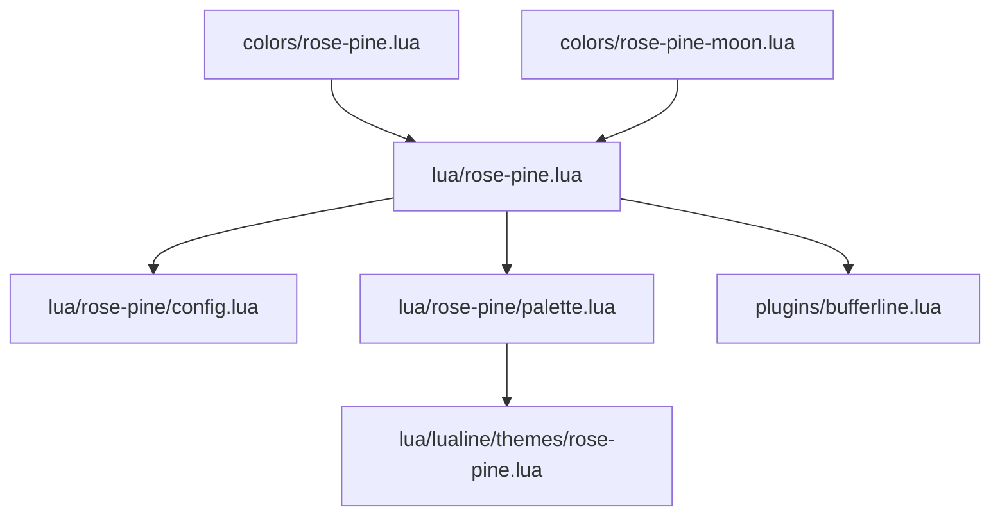

# rose-pine/neovim

> Rosé Pine color theme for Neovim, in three variants: main, moon and dawn.

## The problem
An editor with uncomfortable colors is tiring; you need a theme that is consistent across terminal, editor and plugins.

## What it actually does
Three colors files call a Lua module that merges your configuration with the variant's palette, then generates the highlight groups. It follows vim.o.background (dawn for light, dark_variant for dark), handles transparency, bold and italic styles, and offers integrations for bufferline and lualine.

## How it is wired

## Trying it
No shell command: installation goes through a plugin manager (vim.pack, pam.nvim or lazy.nvim), then `require("rose-pine").setup()` and `vim.cmd("colorscheme rose-pine")`.

## Cost and gotchas
Free. You must configure the options before calling colorscheme. Quiet repo (last push in May 2026), 5 open issues.

## What it is not
Not a functional plugin: it only changes colors. It does not provide a theme for your other tools (see the wiki for recipes).

## Alternatives
No alternative cited in the README.

## For you
Ignore: cosmetic with no impact on your work; only worth it if you use Neovim and like this palette.
