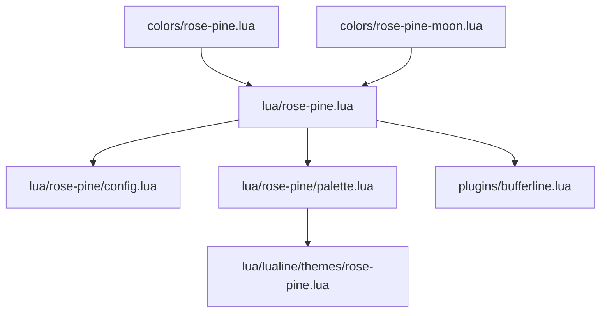

# rose-pine/neovim

> Thème de couleurs Rosé Pine pour Neovim, en trois variantes : main, moon et dawn.

## Le problème
Un éditeur avec des couleurs inconfortables fatigue ; il faut un thème cohérent entre terminal, éditeur et plugins.

## Ce que ça fait vraiment
Trois fichiers colors appellent un module Lua qui fusionne ta configuration avec la palette de la variante, puis génère les groupes de surbrillance. Il suit vim.o.background (dawn en clair, dark_variant en sombre), gère la transparence, les styles gras et italique, et offre des intégrations pour bufferline et lualine.

## Comment c'est branché

## Essayer
Aucune commande shell : l'installation passe par un gestionnaire de plugins (vim.pack, pam.nvim ou lazy.nvim) puis `require("rose-pine").setup()` et `vim.cmd("colorscheme rose-pine")`.

## Coût et pièges
Gratuit. Il faut configurer les options avant d'appeler colorscheme. Dépôt calme (dernier push en mai 2026), 5 issues ouvertes.

## Ce que ce n'est pas
Pas un plugin fonctionnel : il ne change que les couleurs. Il ne fournit pas de thème pour tes autres outils (voir le wiki pour les recettes).

## Alternatives
Aucune alternative citée dans le README.

## Pour toi
Ignorer : cosmétique sans impact sur ton travail ; à prendre seulement si tu es sous Neovim et aimes cette palette.

