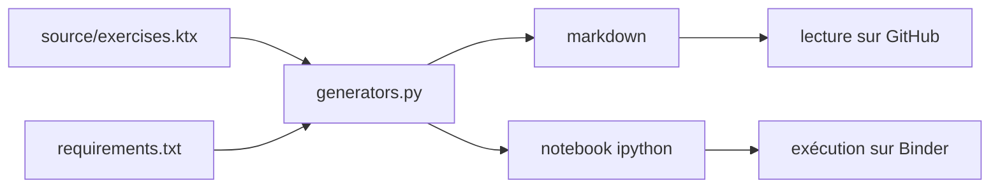

# rougier/numpy-100

> One hundred NumPy exercises, usable as a cheat sheet or as course material.

## The problem
NumPy is learned by practice, but the exercises are scattered across the mailing
list, Stack Overflow and the documentation.

## What it actually does
Gathers one hundred exercises from the NumPy mailing list, Stack Overflow and the
documentation, completed by exercises written by the author to reach one
hundred. Serves both as a quick reference for old and new users, and as an
exercise set for those who teach. Can be read on GitHub or run on Binder. Notable point: the Markdown and the IPython notebook are
generated programmatically from `source/exercises.ktx`; the `ktx` format is a
minimal, readable key-text store. Changing the content therefore goes through the source
and then `generators.py`.

## How it is wired

## Trying it
No install command: the exercises are read on GitHub or run
on Binder. To regenerate the files, run the `generators.py` module with
the libraries from `requirements.txt` installed.

## Cost and gotchas
Free, MIT license. The only trap is editing the Markdown or the notebook
directly: they are generated and any change will be overwritten.

## What it is not
Not a progressive tutorial nor a course: a list of exercises with no pedagogical thread.
No commented solutions described in the README. The repo is stable but
carried by a single person.

## Alternatives
- From Python to NumPy: the same author's book, for extended exercises.
- 100 Julia Exercises: the Julia variant.

## For you
Good material if you have to train someone in NumPy; the "`.ktx` source +
`generators.py`" pattern is reusable for your own generated materials.
