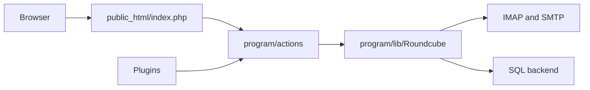

# roundcube/roundcubemail

> Multilingual PHP web mail client speaking IMAP, with address book and plugins.

## The problem
Giving users web access to their IMAP mailboxes without a heavy client.

## What it actually does
PHP/JavaScript application: actions in `program/actions`, IMAP/SMTP/MIME framework in `program/lib/Roundcube`, browser client in jQuery, Elastic skin, plugins. MariaDB, MySQL, PostgreSQL or SQLite database; schemas and migrations in `SQL`. License exception for plugins and skins.

## How it is wired

## Trying it
The README points to INSTALL.md and UPGRADING.md, with no command. Not documented here.

## Cost and gotchas
Free. The repository is a Git snapshot, not a stable release (README warning); a separate database is recommended. 500 open issues.

## What it is not
Not a mail server: you need an IMAP/SMTP server alongside.

## Alternatives
No alternative named in the README.

## For you
Ignore: a webmail unrelated to your work; for a complete server, look instead at a suite like Mailu.
