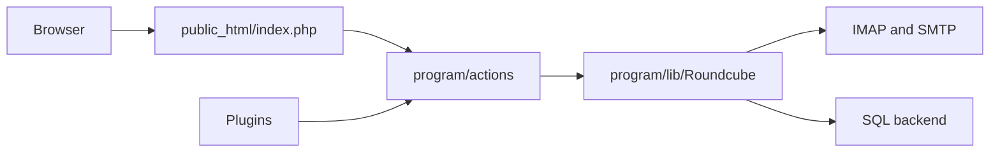

# roundcube/roundcubemail

> Client mail web multilingue en PHP, parlant IMAP, avec carnet d'adresses et plugins.

## Le problème
Offrir à des utilisateurs un accès web à leurs boîtes IMAP sans client lourd.

## Ce que ça fait vraiment
Application PHP/JavaScript : actions dans `program/actions`, cadre IMAP/SMTP/MIME dans `program/lib/Roundcube`, client navigateur en jQuery, skin Elastic, plugins. Base MariaDB, MySQL, PostgreSQL ou SQLite ; schémas et migrations dans `SQL`. Exception de licence pour plugins et skins.

## Comment c'est branché

## Essayer
Le README renvoie à INSTALL.md et UPGRADING.md, sans commande. Non documenté ici.

## Coût et pièges
Gratuit. Le dépôt est un instantané Git, pas une version stable (avertissement du README) ; base séparée recommandée. 500 issues ouvertes.

## Ce que ce n'est pas
Pas un serveur mail : il faut un serveur IMAP/SMTP à côté.

## Alternatives
Aucune alternative nommée dans le README.

## Pour toi
À ignorer : webmail sans lien avec ton métier ; pour un serveur complet, voir plutôt un ensemble type Mailu.

