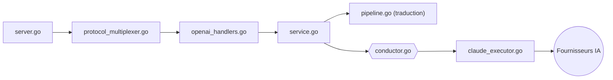

# router-for-me/CLIProxyAPI

> Local Go proxy that exposes your CLI subscriptions (Claude Code, Codex, Gemini, Grok, Kimi) in compatible API formats.

## The problem
The Claude Code, Codex, or Gemini CLI subscriptions are only valid within their respective tools. To use them with another client or SDK, a separate, paid API key is required.

## What it actually does
A Go server that receives requests in OpenAI (responses included), Gemini, or Claude format, translates them to the target provider's format, and executes them using OAuth accounts or keys.
The "conductor" chooses the account: round-robin multi-accounts, weighting, retries, cooldowns, and quota switching.
Streaming, WebSocket, tools, and images. Configuration is dynamically updated by a watcher; API for management; native plugins; embeddable Go SDK.
More built-in usage statistics since version 6.10.0: a third-party project (CPA Usage Keeper, CPA-Manager-Plus) is required.

## How it is wired


## Trying it
```bash
# Aucune commande documentée dans le README :
# l'installation renvoie au guide https://help.router-for.me/
```

## Cost and gotchas
The proxy is free, but each account connected to it requires a subscription or license that you are responsible for. The README refers (via the WebBrain project) to a guide on "account risk": sharing subscriptions behind a proxy is not neutral towards providers.

## What it is not
Not a model provider: without an account with OpenAI, Anthropic, Google, or xAI, it is useless.
Not a dashboard: usage and cost tracking are delegated to third-party projects.
Redis and PostgreSQL are optional, but appear when you switch to a cluster.

## Alternatives
- 9Router: Re-implementation of Next.js with a web dashboard and automatic fallback.
- OmniRoute: A routing-focused platform offering free or low-cost models, with quotas and caching features.
- Codex Switch: If you only want to switch between Codex accounts without using a proxy.

## For you
Ideal for testing your agents across multiple models using your existing subscriptions; not for team use.
