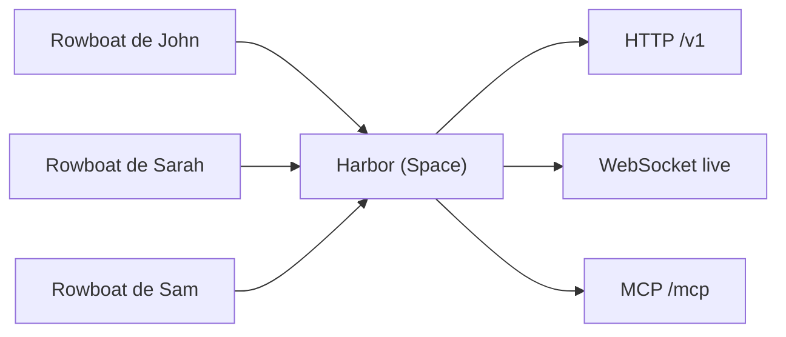

# rowboatlabs/rowboat

> Desktop assistant that indexes emails, meetings and notes into a knowledge graph and has agents work on your machine.

## The problem
AI assistants rebuild context on every request; the memory of your work stays scattered across emails, meetings and documents.

## What it actually does
Electron application: "Brain" (a local graph of back-linked Markdown notes), a mail client with drafts, background agents triggered by events or schedules, an isolated browser, meeting note-taking, a code mode driving Claude Code or Codex, internal apps. Local models (Ollama, LM Studio) or API-key models; MCP. New: shared "Spaces", hosted on a self-hostable Harbor server (Postgres), reachable by any agent via MCP.

## How it is wired


## Trying it
```bash
cd apps/harbor && pnpm install --frozen-lockfile && pnpm -r build
cd ../x && pnpm install --frozen-lockfile
cd apps/main && npm run package
cd apps/harbor && pnpm install && pnpm build && cd packages/server && pnpm dev
```

## Cost and gotchas
The application is free (Apache-2.0); keys are at your expense (Deepgram, ElevenLabs, Exa, Composio, models). The hosted server requires a Google/Microsoft account. Node 22 or 24 to package. Harbor: breaking changes announced ("dogfood").

## What it is not
The supplied architecture diagram describes an older version (Next.js, Python agents): not reproduced here. Private data is shared only on request, in summarized form.

## Alternatives
No alternative named in the README.

## For you
An interesting concept of local memory plus agents for your AI workflow, but young and unstable: worth watching.
