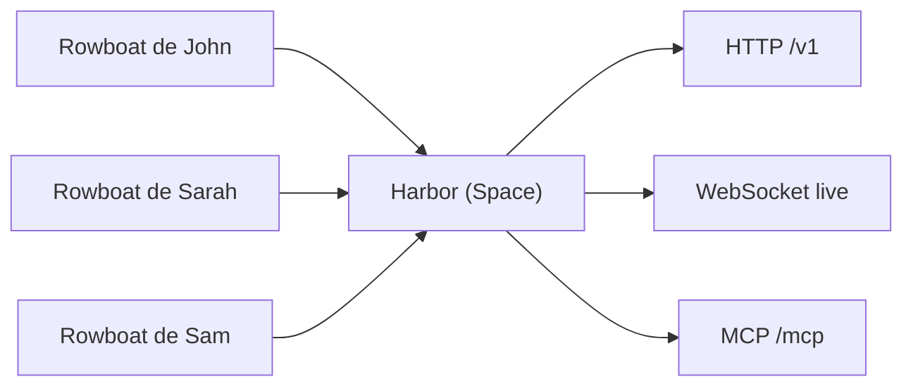

# rowboatlabs/rowboat

> Assistant de bureau qui indexe mails, réunions et notes en graphe de connaissances et fait travailler des agents sur ta machine.

## Le problème
Les assistants IA reconstruisent le contexte à chaque requête ; la mémoire du travail reste dispersée entre mails, réunions et documents.

## Ce que ça fait vraiment
Application Electron : « Brain » (graphe de notes Markdown rétro-lié, local), client mail avec brouillons, agents d'arrière-plan sur événement ou planning, navigateur isolé, prise de notes de réunion, mode code pilotant Claude Code ou Codex, apps internes. Modèles locaux (Ollama, LM Studio) ou à clé d'API ; MCP. Nouveauté : les « Spaces » partagés, hébergés sur un serveur Harbor (Postgres) auto-hébergeable, que n'importe quel agent atteint via MCP.

## Comment c'est branché


## Essayer
```bash
cd apps/harbor && pnpm install --frozen-lockfile && pnpm -r build
cd ../x && pnpm install --frozen-lockfile
cd apps/main && npm run package
cd apps/harbor && pnpm install && pnpm build && cd packages/server && pnpm dev
```

## Coût et pièges
Application gratuite (Apache-2.0) ; clés à ta charge (Deepgram, ElevenLabs, Exa, Composio, modèles). Serveur hébergé nécessite un compte Google/Microsoft. Node 22 ou 24 pour empaqueter. Harbor : ruptures annoncées (« dogfood »).

## Ce que ce n'est pas
Le diagramme d'architecture fourni décrit une ancienne version (Next.js, agents Python) : non repris ici. Données privées partagées seulement sur demande, résumées.

## Alternatives
Aucune alternative nommée dans le README.

## Pour toi
Concept de mémoire locale + agents intéressant pour ton workflow IA, mais jeune et instable : à surveiller.

