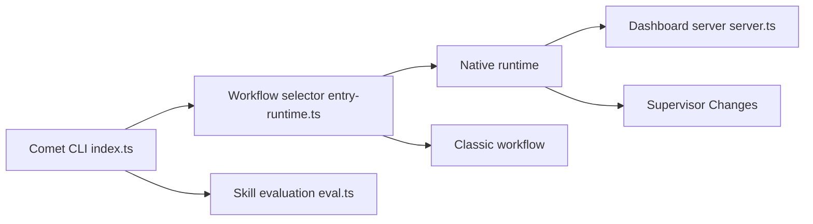

# rpamis/comet

> Resumable workflow platform for coding agents, with skill creation and evaluation.

## The problem
Long coding-agent tasks lose their state at every interruption, and skills get improved by gut feeling rather than by measurement.

## What it actually does
Two independent workflows: Native (the model picks the method, Comet handles state, verification and archiving) and Classic (five OpenSpec + Superpowers phases with a state machine and guard scripts). "Supervisor Changes" split a goal into sub-changes on isolated worktrees. On top come personal memory, project knowledge, a dashboard and `comet eval` (rubric, Pass@k, Pass^k, LangSmith).

## How it is wired


## Trying it
```bash
npm install -g @rpamis/comet
cd your-project
comet init
comet init --workflow classic
```
Then invoke `/comet` in the host.

## Cost and gotchas
Node.js 22.16+ or 24+, npm and Git. The advertised gains (76.8% fewer tokens) come from the authors' own experiment on 16 tasks; conditions and limits are in their report.

## What it is not
Not an agent in itself: it orchestrates existing agents (Codex, Claude Code). Native and Classic are not tiers of one another.

## Alternatives
- OpenSpec and Superpowers: components of the Classic method.

## For you
Worth watching: interesting for structuring long sessions with skill measurement, but young (created in May 2026) and heavy to adopt.
