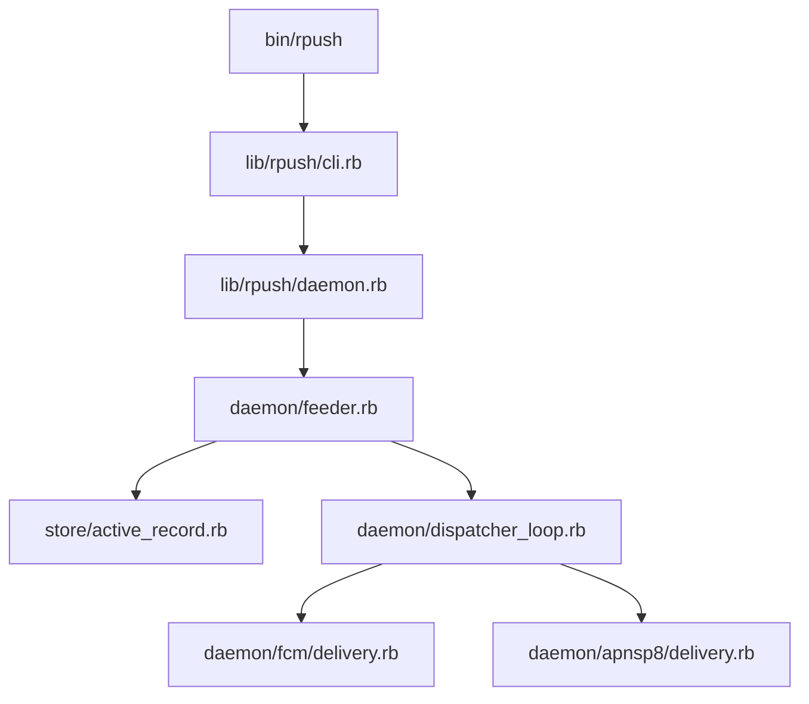

# rpush/rpush

> Ruby service for sending push notifications to iOS, Android, Windows and browsers, for Rails applications.

## The problem
Sending notifications to several platforms means handling each protocol, persistent connections and failures.

## What it actually does
A daemon (or embedded mode, command line, scheduled task) that reads notifications from ActiveRecord or Redis and distributes them to delivery backends: APNs (certificate or p8 token), Firebase Cloud Messaging, Amazon Device Messaging, WNS, Pushy, Webpush. Bugsnag, Sentry and StatsD plugins; a reflection API for hooks.

## How it is wired


## Trying it
```bash
bundle exec rpush init
rpush start
rpush start -f
rpush push
```

## Cost and gotchas
Free, but requires accounts with Apple, Google or Microsoft (certificates, service keys). Delivered notifications remain in the database: clean them up, especially on Redis. Tests require an `rpush_test` database.

## What it is not
Not a hosted service: you run the daemon yourself. No Web Push support on Safari (use APNs).

## Alternatives
No alternative named in the README.

## For you
Ignore: a notification building block for Ruby apps, unrelated to data or AI.
