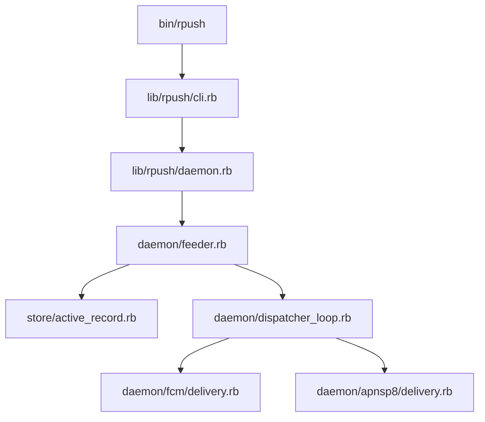

# rpush/rpush

> Service Ruby d'envoi de notifications push vers iOS, Android, Windows et navigateurs, pour applications Rails.

## Le problème
Envoyer des notifications à plusieurs plateformes impose de gérer chaque protocole, les connexions persistantes et les échecs.

## Ce que ça fait vraiment
Daemon (ou mode embarqué, ligne de commande, tâche planifiée) qui lit les notifications dans ActiveRecord ou Redis et les distribue aux livreurs : APNs (certificat ou jeton p8), Firebase Cloud Messaging, Amazon Device Messaging, WNS, Pushy, Webpush. Plugins Bugsnag, Sentry, StatsD ; API de réflexion pour les hooks.

## Comment c'est branché


## Essayer
```bash
bundle exec rpush init
rpush start
rpush start -f
rpush push
```

## Coût et pièges
Gratuit, mais exige des comptes chez Apple, Google ou Microsoft (certificats, clés de service). Les notifications livrées restent en base : à nettoyer, surtout sur Redis. Les tests demandent une base `rpush_test`.

## Ce que ce n'est pas
Pas un service hébergé : on exploite soi-même le daemon. Pas de support du Web Push sur Safari (utiliser APNs).

## Alternatives
Aucune alternative nommée dans le README.

## Pour toi
À ignorer : brique de notifications pour apps Ruby, sans rapport avec la data ou l'IA.

