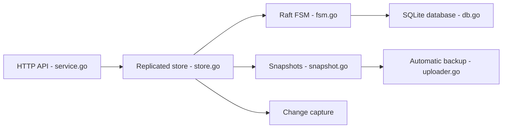

# rqlite/rqlite

> Distributed, fault-tolerant relational database built on SQLite, driven over HTTP.

## The problem
SQLite is not replicated; you want a small, highly available relational store without a heavy installation.

## What it actually does
A single binary exposes an HTTP API: requests go through a replicated store (Raft consensus), then the FSM applies them to SQLite. Features: full SQL (full-text search, JSON), SQLite extensions (vector search), atomic requests, change capture, dynamic clustering (Kubernetes, Consul, etcd, DNS), hot backups to S3/GCS, TLS, tunable read consistency.

## How it is wired


## Trying it
```bash
docker run -p 4001:4001 rqlite/rqlite
curl -XPOST 'localhost:4001/db/execute?pretty' -H 'Content-Type: application/json' -d '[
     "CREATE TABLE foo (id INTEGER NOT NULL PRIMARY KEY, name TEXT)",
     "INSERT INTO foo(id, name) VALUES(1, \"fiona\")"
]'
curl -G 'localhost:4001/db/query?pretty' --data-urlencode 'q=SELECT * FROM foo'
```

## Cost and gotchas
Free. Governance not specified in the README (project associated with a main author, inferred from the name). Write throughput remains limited by replication.

## What it is not
Not a replacement for PostgreSQL for large volumes or intensive transactional workloads. It is "etcd with relational" according to the README.

## Alternatives
No alternative named in the README (etcd is cited as a comparison).

## For you
Watch: handy for a small replicated metadata store at the edge or on Kubernetes; avoid for analytics.
