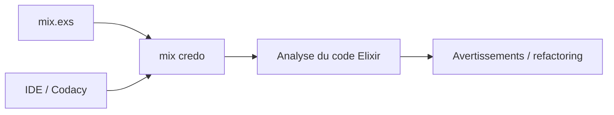

# rrrene/credo

> Static analysis for Elixir, focused on teaching and code consistency.

## The problem
Keeping Elixir code consistent and catching common mistakes and complexity without manual review.

## What it actually does
Suggests refactorings, spots complex fragments, frequent mistakes and naming inconsistencies, and can enforce a style. Added as a Mix dependency. Integrations: IntelliJ, Atom, VSCode, Emacs flycheck, Kakoune, Neovim via null-ls, Codacy.

## How it is wired


## Trying it
```bash
# mix.exs : {:credo, "~> 1.7", only: [:dev, :test], runtime: false}
mix deps.get
mix credo
```

## Cost and gotchas
Free. Full docs on Hexdocs. Elixir ecosystem only: you need Elixir and Mix to install and use it, which is not relevant for a Python project.

## What it is not
Not a code formatter nor a type checker.

## Alternatives
No alternative named.

## For you
Ignore: it is a static code analyzer for Elixir, useful only for Elixir codebases. No use for data, AI or MLOps in Python.
