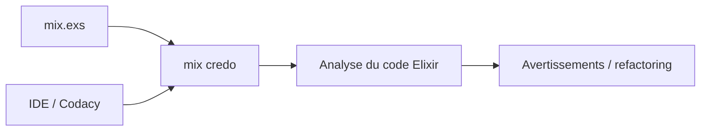

# rrrene/credo

> Analyse statique pour Elixir, axée sur la pédagogie et la cohérence du code.

## Le problème
Garder un code Elixir cohérent et repérer erreurs courantes et complexité sans relecture manuelle.

## Ce que ça fait vraiment
Propose des pistes de refactoring, repère les fragments complexes, les erreurs fréquentes, les incohérences de nommage et peut imposer un style. S'ajoute comme dépendance Mix. Intégrations : IntelliJ, Atom, VSCode, Emacs flycheck, Kakoune, Neovim via null-ls, Codacy.

## Comment c'est branché


## Essayer
```bash
# mix.exs : {:credo, "~> 1.7", only: [:dev, :test], runtime: false}
mix deps.get
mix credo
```

## Coût et pièges
Gratuit. Doc complète sur Hexdocs.

## Ce que ce n'est pas
Pas un formateur de code ni un vérificateur de types.

## Alternatives
Aucune alternative nommée.

## Pour toi
Ignorer : ne sert qu'aux bases Elixir.

