# rs/zerolog

> Structured JSON logger for Go with a chained API, for allocation-sensitive Go services.

## The problem
Classic Go loggers rely on reflection and allocate on every event, which weighs on hot paths.
Without typed fields, the JSON produced is inconsistent and hard to query downstream.

## What it actually does
Writes JSON events (or CBOR with the `binary_log` build tag) through a `log.Info().Str(...).Msg(...)` chain.
Typed fields (`Str`, `Int`, `Dur`, `Dict`, `RawJSON`, `IPAddr`…), sub-loggers, hooks, sampling (`BasicSampler`, `BurstSampler`).
Provided integrations: `net/http` via `hlog`, `log/slog` via `NewSlogHandler`, stacktraces via `pkgerrors`.
`ConsoleWriter` gives human-readable output in development, at the cost of performance; `diode.Writer` decouples a slow writer.

## How it is wired

```mermaid
flowchart TD
  A[log.Info&#40;&#41; chaîne d'appels] --> B[zerolog.Event champs typés]
  B --> C[Hooks + Sampler]
  C --> D[Encodeur JSON ou CBOR]
  D --> E[io.Writer os.Stderr]
  D --> F[zerolog.ConsoleWriter]
  D --> G[diode.Writer non bloquant]
  H[hlog / NewSlogHandler] --> A
```


## Trying it
```bash
go get -u github.com/rs/zerolog/log
go build -tags binary_log .
```

## Cost and gotchas
Free, no key or service. Code pitfall: forgetting `Msg`/`Msgf` at the end of the chain makes the event disappear with no compile error.
The default global level is `trace`, so everything goes to stderr until you call `SetGlobalLevel`. `Msgf` allocates even with a disabled logger.

## What it is not
Not a collector or a log backend: it writes to an `io.Writer`, what follows is up to you.
Not a logger for a human console — `ConsoleWriter` is described as inefficient.
Not a replacement for `slog`: it is the opposite, it provides a handler for `slog`.

## Alternatives
- uber-go/zap: pioneering approach cited by the README, fewer allocations in some measured cases.
- logrus: simpler API, per-event cost far higher according to the README tables.
- go-kit/log: if you are already in the go-kit ecosystem.

## For you
Useful only if you write Go services or exporters; on the Python/MLOps side, it does not concern you.
