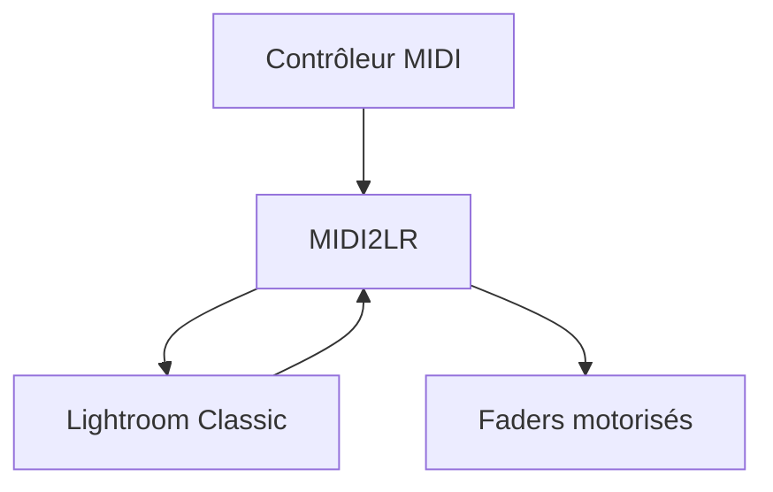

# rsjaffe/MIDI2LR

> Connects a MIDI controller to Lightroom Classic to control photo settings with knobs.

## The problem
Adjusting Lightroom's develop sliders with the mouse is slow when retouching many photos.

## What it actually does
Turns MIDI messages into develop-parameter updates and actions on photos. Sends MIDI back to motorized-fader controllers when a parameter changes. Interface in more than fifteen languages.

## How it is wired

Simplified diagram based on the sheet, no diagram provided.

## Trying it
```bash
# Aucune commande documentée dans le README.
```

## Cost and gotchas
Free, but Lightroom Classic is required (v4: Lightroom 10, v5: Lightroom 11, v3 for older versions). Paid Adobe license at your expense.

## What it is not
Not an image or data processing tool: it is a hardware control bridge. Installation not detailed in the README.

## Alternatives
No alternative named in the README.

## For you
Unrelated to data / AI / MLOps; ignore unless you retouch photos in Lightroom.
