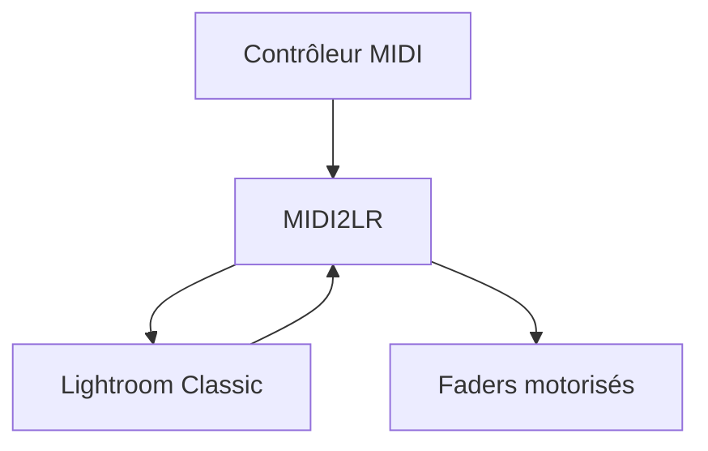

# rsjaffe/MIDI2LR

> Relie un contrôleur MIDI à Lightroom Classic pour piloter les réglages photo avec des potentiomètres.

## Le problème
Régler les curseurs de développement de Lightroom à la souris est lent quand on retouche beaucoup de photos.

## Ce que ça fait vraiment
Transforme les messages MIDI en mises à jour de paramètres de développement et en actions sur les photos. Renvoie du MIDI aux contrôleurs à faders motorisés quand un paramètre change. Interface en plus de quinze langues.

## Comment c'est branché

Schéma simplifié d'après la fiche, sans diagramme fourni.

## Essayer
```bash
# Aucune commande documentée dans le README.
```

## Coût et pièges
Gratuit, mais Lightroom Classic est requis (v4 : Lightroom 10, v5 : Lightroom 11, v3 pour les versions plus anciennes). Licence payante d'Adobe à ta charge.

## Ce que ce n'est pas
Pas un outil de traitement d'images ni de données : c'est un pont de commande matériel. Installation non détaillée dans le README.

## Alternatives
Aucune alternative nommée dans le README.

## Pour toi
Sans rapport avec la data / IA / MLOps ; à ignorer sauf si tu retouches des photos sous Lightroom.

