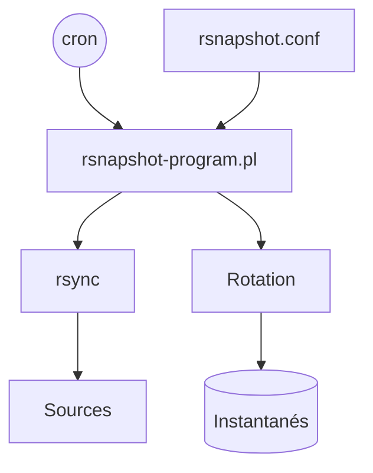

# rsnapshot/rsnapshot

> Snapshot backup utility based on rsync, using hard links, for Unix administrators.

## The problem
Periodic full backups consume too much space and are hard to manage by hand.

## What it actually does
- Takes snapshots of local or remote machines over SSH.
- Reuses unchanged files through hard links to save disk space.
- Rotation by intervals (alpha, beta, gamma…) triggered by cron.
- Written in Perl with no module dependency.

## How it is wired


## Trying it
```bash
rsnapshot configtest
rsnapshot -t alpha
0 */4 * * *     /usr/local/bin/rsnapshot alpha
```

## Cost and gotchas
Free, GPL-2.0. Config in `/etc/rsnapshot.conf`; `link_dest` handles unreachable hosts poorly (full resynchronization).

## What it is not
Not an online or encrypted backup: it copies files to a disk you provide. No native cloud support.

## Alternatives
No alternative named in the README.

## For you
Worth watching: simple, lean backup for a data server, but not suited to very large volumes or the cloud.
