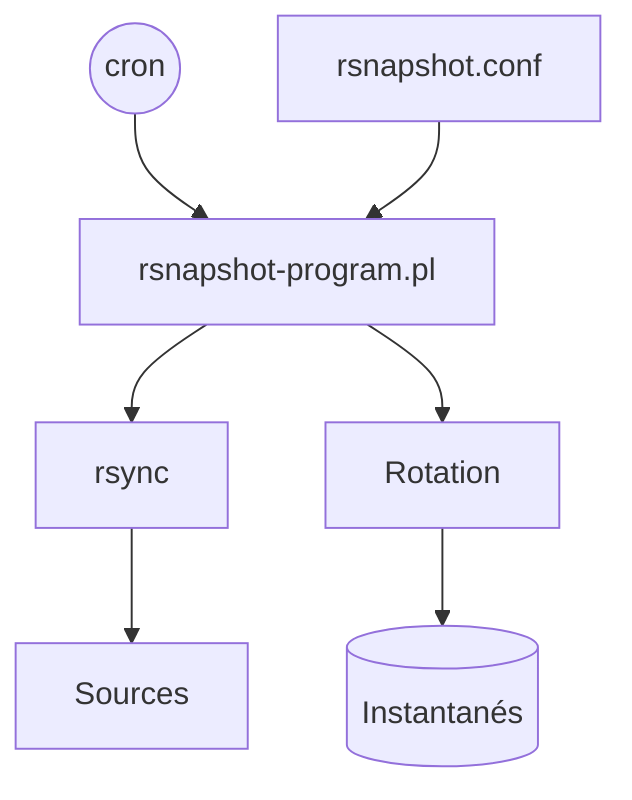

# rsnapshot/rsnapshot

> Utilitaire de sauvegardes par instantanés basé sur rsync, avec liens physiques, pour administrateurs Unix.

## Le problème
Des sauvegardes complètes périodiques consomment trop d'espace et se gèrent mal à la main.

## Ce que ça fait vraiment
- Prend des instantanés de machines locales ou distantes via SSH.
- Réutilise les fichiers inchangés par liens physiques pour économiser le disque.
- Rotation par intervalles (alpha, beta, gamma…) déclenchés par cron.
- Écrit en Perl sans dépendance de module.

## Comment c'est branché


## Essayer
```bash
rsnapshot configtest
rsnapshot -t alpha
0 */4 * * *     /usr/local/bin/rsnapshot alpha
```

## Coût et pièges
Gratuit, GPL-2.0. Config dans `/etc/rsnapshot.conf` ; `link_dest` gère mal les hôtes injoignables (resynchronisation complète).

## Ce que ce n'est pas
Pas une sauvegarde en ligne ni chiffrée : il copie des fichiers vers un disque que tu fournis. Pas de gestion native du cloud.

## Alternatives
Aucune alternative nommée dans le README.

## Pour toi
À surveiller : sauvegarde simple et sobre pour un serveur de données, mais pas adaptée à de très gros volumes ou au cloud.

