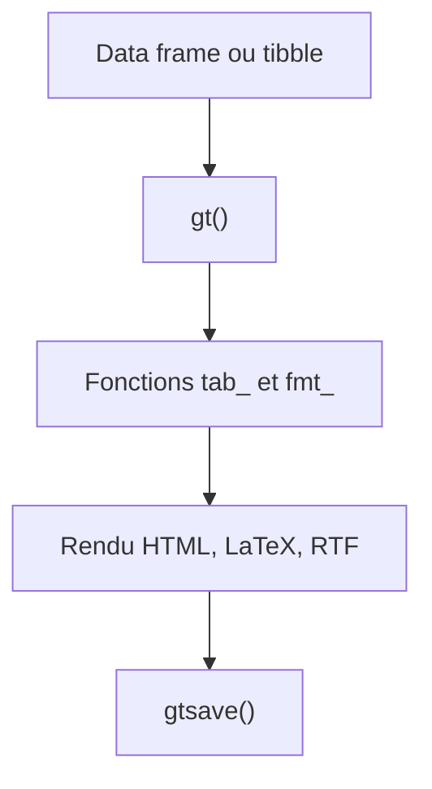

# rstudio/gt

> R package for composing beautiful display tables from a data frame, for R analysts.

## The problem
Raw result tables from a data frame are hard to read in reports and require a lot of manual formatting.

## What it actually does
You start from a data table, then compose the header, label column, columns, body and footer with formatting functions (currency, date, number). Rendered as HTML, LaTeX or RTF; printing, R Markdown document or export via `gtsave()`. Ships with 18 example datasets.

## How it is wired
Simplified diagram based on the fiche, no diagram supplied.


## Trying it
```r
install.packages("gt")
devtools::install_github("rstudio/gt")
```

## Cost and gotchas
Free. Requires R; the Posit Cloud environment lets you try it at no cost. License present but not identified by GitHub; project mostly maintained by one person (Rich Iannone).

## What it is not
Not an analysis or charting tool: it formats tables.

## Alternatives
gtExtras, gtsummary and pointblank: packages that use or extend gt.

## For you
Worth watching if you report results in R; otherwise of little use on the Python side.
