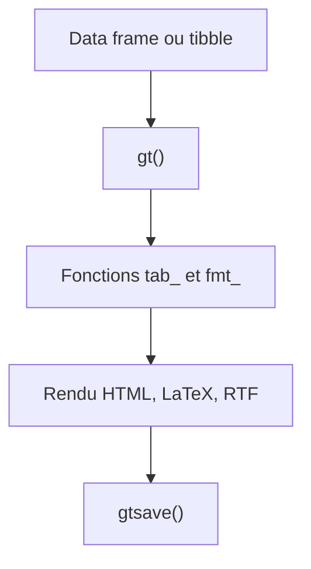

# rstudio/gt

> Package R pour composer de beaux tableaux d'affichage à partir d'un data frame, pour analystes R.

## Le problème
Les tableaux de résultats bruts d'un data frame sont peu lisibles dans les rapports et demandent beaucoup de mise en forme manuelle.

## Ce que ça fait vraiment
On part d'une table de données, puis on compose en-tête, colonne d'étiquettes, colonnes, corps et pied de page avec des fonctions de formatage (devise, date, nombre). Rendu en HTML, LaTeX ou RTF ; impression, document R Markdown ou export par `gtsave()`. Fournit 18 jeux de données d'exemple.

## Comment c'est branché
Schéma simplifié d'après la fiche, sans diagramme fourni.


## Essayer
```r
install.packages("gt")
devtools::install_github("rstudio/gt")
```

## Coût et pièges
Gratuit. Demande R ; l'environnement Posit Cloud sert à l'essai sans frais. Licence présente mais non identifiée par GitHub ; projet surtout entretenu par une personne (Rich Iannone).

## Ce que ce n'est pas
Pas un outil d'analyse ni de graphiques : il met en forme des tableaux.

## Alternatives
gtExtras, gtsummary et pointblank : paquets qui utilisent ou étendent gt.

## Pour toi
À surveiller si tu rapportes des résultats en R ; sinon peu utile côté Python.

