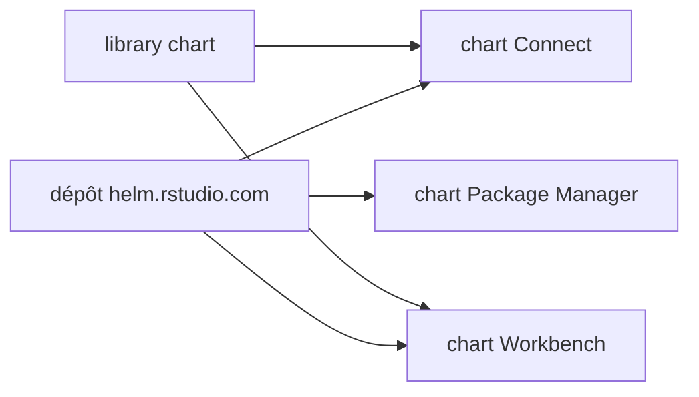

# rstudio/helm

> Posit Helm charts to deploy Connect, Workbench and Package Manager on Kubernetes.

## The problem
Deploying Posit products on Kubernetes requires many manifests (images, RBAC, job launcher) to maintain.

## What it actually does
Publishes charts for Posit Connect, Workbench and Package Manager (Chronicle is marked deprecated). It adds a library chart, an image pre-pulling chart and examples, including a standalone RBAC for the Job Launcher. Version 0.20.0 moved the default images to `posit/` and `ghcr.io/posit-dev/`.

## How it is wired
Simplified diagram based on the sheet, no diagram provided.



## Trying it
```console
helm repo add rstudio https://helm.rstudio.com
helm search repo rstudio
```

## Cost and gotchas
Free, but Posit products in practice require separate licenses, not detailed here. A Kubernetes cluster and Helm are required. The breaking changes in 0.20.0 make reading the migration guide mandatory.

## What it is not
Not the products themselves: only their deployment. The 174 open issues indicate a heavy backlog.

## Alternatives
No alternative named in the README.

## For you
Worth watching: relevant if your data team deploys RStudio or Posit on Kubernetes, otherwise irrelevant.
