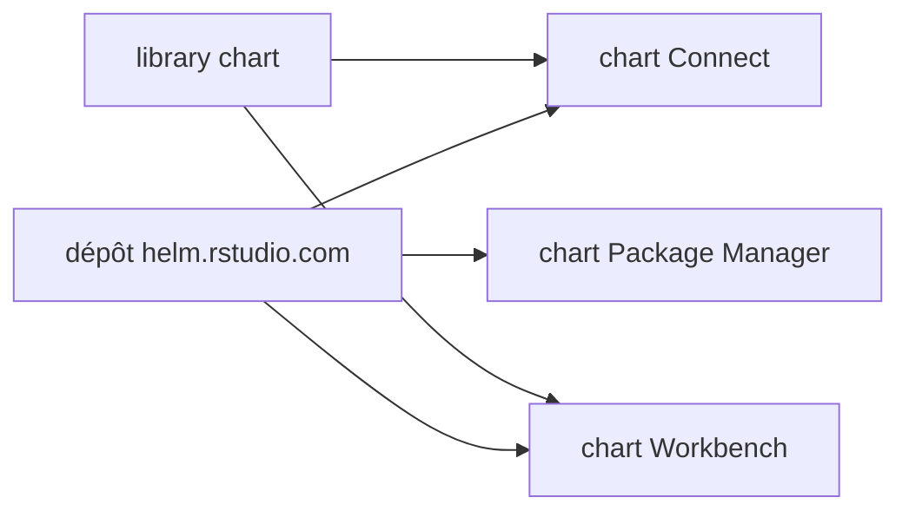

# rstudio/helm

> Charts Helm de Posit pour déployer Connect, Workbench et Package Manager sur Kubernetes.

## Le problème
Déployer les produits Posit sur Kubernetes demande de nombreux manifestes (images, RBAC, lanceur de jobs) à maintenir.

## Ce que ça fait vraiment
Publie des charts pour Posit Connect, Workbench et Package Manager (Chronicle est marqué déprécié). Il ajoute un chart de bibliothèque, un chart de pré-chargement d'images et des exemples, dont un RBAC autonome pour le Job Launcher. La version 0.20.0 a déplacé les images par défaut vers `posit/` et `ghcr.io/posit-dev/`.

## Comment c'est branché
Schéma simplifié d'après la fiche, sans diagramme fourni.



## Essayer
```console
helm repo add rstudio https://helm.rstudio.com
helm search repo rstudio
```

## Coût et pièges
Gratuit, mais les produits Posit exigent en pratique des licences à part, non détaillées ici. Un cluster Kubernetes et Helm sont requis. Les changements cassants de la 0.20.0 imposent de lire le guide de migration.

## Ce que ce n'est pas
Pas les produits eux-mêmes : seulement leur déploiement. Les 174 issues ouvertes indiquent un suivi chargé.

## Alternatives
Aucune alternative nommée dans le README.

## Pour toi
À surveiller : pertinent si ton équipe data déploie RStudio ou Posit sur Kubernetes, sinon sans objet.

