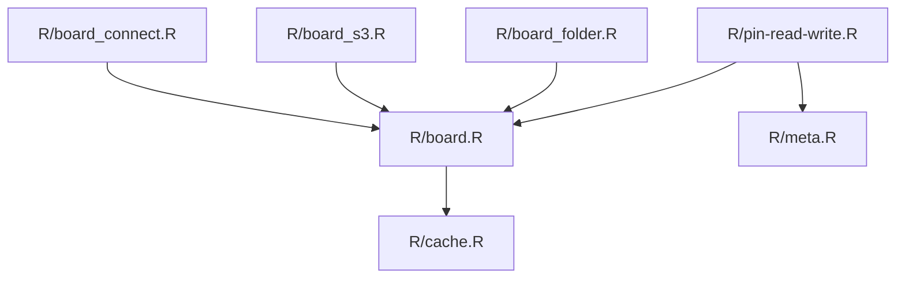

# rstudio/pins-r

> R package for publishing and sharing data and models on "boards", with automatic versioning.

## The problem
Sharing a dataset or a model between projects and colleagues goes through file copies with no history.

## What it actually does
`pin_write` saves an object to a board, `pin_read` reads it back. Boards can be a folder, Posit Connect, Databricks, S3, Google Cloud Storage, Azure or Microsoft 365. Versions are kept. The default format is Parquet, with RDS, Arrow, CSV or JSON as options. A Python version can read the same pins back.

## How it is wired
Diagram based on the code diagram.


## Trying it
```bash
Rscript -e 'install.packages("pins")'
Rscript -e 'pak::pak("rstudio/pins-r")'
```
Then in R: `board <- board_temp()`, `board |> pin_write(head(mtcars), "mtcars")`, `board |> pin_read("mtcars")`.

## Cost and gotchas
Free. Cloud boards or Posit Connect require an account and storage costs on your side. A license is present but not identified by GitHub.

## What it is not
It is not a full model registry like MLflow. It is versioned sharing of objects.

## Alternatives
No alternative named in the README, which only points to pins for Python.

## For you
Adopt if you work in R: version and share datasets and models simply, with a Python counterpart.
