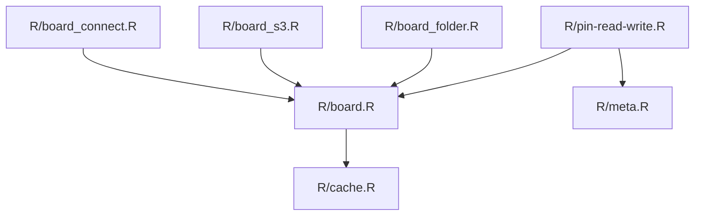

# rstudio/pins-r

> Paquet R pour publier et partager données et modèles sur des « boards », avec versions automatiques.

## Le problème
Partager un jeu de données ou un modèle entre projets et collègues passe par des copies de fichiers sans historique.

## Ce que ça fait vraiment
`pin_write` enregistre un objet sur un board, `pin_read` le relit. Les boards peuvent être un dossier, Posit Connect, Databricks, S3, Google Cloud Storage, Azure ou Microsoft 365. Les versions sont conservées. Le format par défaut est Parquet, avec RDS, Arrow, CSV ou JSON en option. Une version Python permet de relire les mêmes pins.

## Comment c'est branché
Schéma d'après le diagramme du code.


## Essayer
```bash
Rscript -e 'install.packages("pins")'
Rscript -e 'pak::pak("rstudio/pins-r")'
```
Puis en R : `board <- board_temp()`, `board |> pin_write(head(mtcars), "mtcars")`, `board |> pin_read("mtcars")`.

## Coût et pièges
Gratuit. Les boards cloud ou Posit Connect demandent un compte et un coût de stockage à ta charge. La licence est présente mais non identifiée par GitHub.

## Ce que ce n'est pas
Ce n'est pas un registre de modèles complet comme MLflow. C'est un partage versionné d'objets.

## Alternatives
Aucune alternative nommée dans le README, qui renvoie seulement à pins pour Python.

## Pour toi
À adopter si tu travailles en R : versionne et partage jeux de données et modèles simplement, avec un pendant Python.

