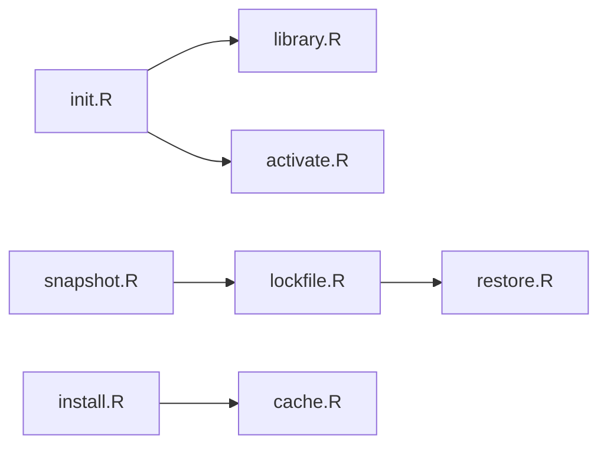

# rstudio/renv

> Isolated, reproducible R environments per project, with package version locking.

## The problem
Updating a package for one project breaks the others, and nothing guarantees the same versions on another machine.

## What it actually does
`renv::init()` creates a private library per project and a `.Rprofile`. `snapshot()` records versions and sources in `renv.lock`, `restore()` reinstalls them elsewhere, `status()` compares the library with the lockfile. Shared package cache; a native helper in C.

## How it is wired


## Trying it
```bash
install.packages("renv")
renv::init()
renv::snapshot()
renv::restore()
```
(R commands)

## Cost and gotchas
Free. "Stable" lifecycle announced. Does not manage the R version itself: not documented in the README.

## What it is not
Not Docker: it isolates R packages, not the system.

## Alternatives
The README names no alternative.

## For you
Keep an eye on it: the R equivalent of venv + lockfile; useful only if you work in R.
