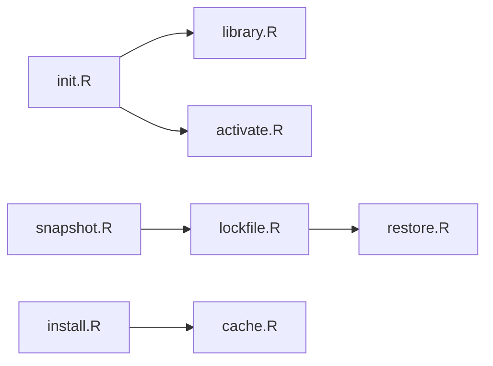

# rstudio/renv

> Environnements R isolés et reproductibles par projet, avec verrouillage des versions de paquets.

## Le problème
Mettre à jour un paquet pour un projet casse les autres, et rien ne garantit les mêmes versions sur une autre machine.

## Ce que ça fait vraiment
`renv::init()` crée une bibliothèque privée par projet et un `.Rprofile`. `snapshot()` enregistre versions et sources dans `renv.lock`, `restore()` les réinstalle ailleurs, `status()` compare bibliothèque et lockfile. Cache partagé de paquets ; un helper natif en C.

## Comment c'est branché


## Essayer
```bash
install.packages("renv")
renv::init()
renv::snapshot()
renv::restore()
```
(commandes R)

## Coût et pièges
Gratuit. Cycle de vie « stable » annoncé. Ne gère pas la version de R elle-même : non documenté dans le README.

## Ce que ce n'est pas
Pas Docker : il isole les paquets R, pas le système.

## Alternatives
Le README ne nomme pas d'alternative.

## Pour toi
À surveiller : l'équivalent R de venv + lockfile ; utile seulement si tu travailles en R.

