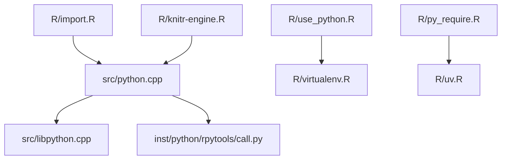

# rstudio/reticulate

> R package that embeds a Python session in R, for bilingual data scientists.

## The problem
Teams that use both R and Python have to export files between the two languages.

## What it actually does
It calls Python from R: modules imported with `import()`, scripts sourced with `source_python()`, an embedded REPL, a Python engine for R Markdown. It automatically converts R matrices to NumPy arrays and data frames to pandas DataFrames. It picks the Python environment (virtualenv, conda, uv).

## How it is wired


## Trying it
```r
install.packages("reticulate")
library(reticulate)
use_python("/usr/local/bin/python")
os <- import("os")
os$listdir(".")
```

## Cost and gotchas
Free. A Python installation is required (by default an isolated "r-reticulate" virtualenv). Array conversions between R and Python have subtleties. 477 open issues.

## What it is not
Not a machine-learning library: it is a language bridge.

## Alternatives
No alternative named in the README.

## For you
Adopt if your team mixes R and Python: long-standing project, actively maintained by Posit, and the pandas / NumPy conversion avoids file round-trips.
