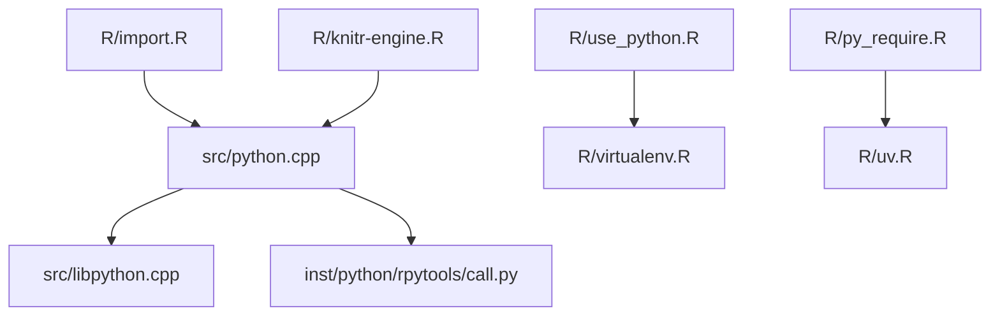

# rstudio/reticulate

> Paquet R qui embarque une session Python dans R, pour data scientists bilingues.

## Le problème
Les équipes qui utilisent R et Python doivent exporter des fichiers entre les deux langages.

## Ce que ça fait vraiment
Il appelle Python depuis R : modules importés avec `import()`, scripts sourcés avec `source_python()`, REPL embarqué, moteur Python pour R Markdown. Il convertit automatiquement matrices R en tableaux NumPy et data frames en DataFrames pandas. Il choisit l'environnement Python (virtualenv, conda, uv).

## Comment c'est branché


## Essayer
```r
install.packages("reticulate")
library(reticulate)
use_python("/usr/local/bin/python")
os <- import("os")
os$listdir(".")
```

## Coût et pièges
Gratuit. Il faut un Python installé (par défaut un virtualenv isolé « r-reticulate »). Les conversions de tableaux entre R et Python ont des subtilités. 477 issues ouvertes.

## Ce que ce n'est pas
Ce n'est pas une bibliothèque d'apprentissage automatique : c'est un pont de langage.

## Alternatives
Aucune alternative nommée dans le README.

## Pour toi
À adopter si ton équipe mélange R et Python : projet ancien, activement maintenu par Posit, et la conversion pandas / NumPy évite des allers-retours de fichiers.

