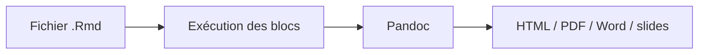

# rstudio/rmarkdown

> R package that blends code, results and text into reproducible documents, for R analysts and data scientists.

## The problem
Analyses pasted into reports drift out of sync with the data and code, and are not reproducible.

## What it actually does
An `.Rmd` file contains Markdown text and code chunks. Rendering runs the code and produces HTML, PDF, Word, slideshows. Pandoc (1.12.3 or later) is required; RStudio bundles it. The Knit button triggers rendering.

## How it is wired

Diagram drawn from the README text, without code detail.

## Trying it
```bash
install.packages("rmarkdown")
pak::pak('rstudio/rmarkdown')
```
(R commands, to run in an R console)

## Cost and gotchas
Free. Pandoc needed outside RStudio. PDF generally assumes a LaTeX toolchain, not documented in this README.

## What it is not
Not an interactive notebook like Jupyter: it is document rendering. License present but not identified by GitHub.

## Alternatives
The README names no alternative.

## For you
Keep an eye on it: a reference for reproducible reporting in R; if your stack is Python, Jupyter is more natural.
