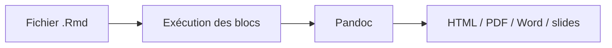

# rstudio/rmarkdown

> Package R qui mêle code, résultats et texte dans des documents reproductibles, pour analystes et data scientists R.

## Le problème
Les analyses copiées dans des rapports se désynchronisent des données et du code, et ne sont pas reproductibles.

## Ce que ça fait vraiment
Un fichier `.Rmd` contient du texte Markdown et des blocs de code. Le rendu exécute le code et produit HTML, PDF, Word, diaporamas. Pandoc (1.12.3 ou plus) est requis ; RStudio l'embarque. Le bouton Knit déclenche le rendu.

## Comment c'est branché

Schéma tiré du texte du README, sans détail de code.

## Essayer
```bash
install.packages("rmarkdown")
pak::pak('rstudio/rmarkdown')
```
(commandes R, à lancer dans une console R)

## Coût et pièges
Gratuit. Pandoc nécessaire hors RStudio. Le PDF suppose en général une chaîne LaTeX, non documentée dans ce README.

## Ce que ce n'est pas
Pas un notebook interactif à la Jupyter : c'est un rendu de documents. Licence présente mais non identifiée par GitHub.

## Alternatives
Le README ne nomme pas d'alternative.

## Pour toi
À surveiller : référence pour le reporting reproductible en R ; si ton stack est Python, Jupyter est plus naturel.

