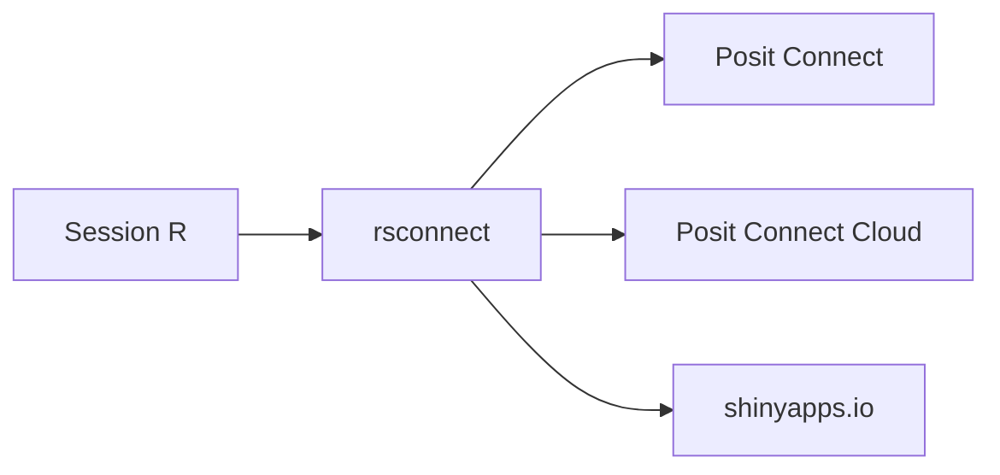

# rstudio/rsconnect

> R package that publishes Shiny apps, RMarkdown documents, Quarto and Plumber APIs to Posit Connect or shinyapps.io.

## The problem
Deploying an R app or report to a publishing server by hand is repetitive and error-prone.

## What it actually does
Registers a target server (Posit Connect, Connect Cloud or shinyapps.io) with browser, API key or token authentication. The `deployApp()` and `deployDoc()` functions then publish apps, documents and APIs. The Python equivalent exists under the name rsconnect-python.

## How it is wired
Simplified diagram based on the sheet, no diagram provided.



## Trying it
```bash
install.packages("rsconnect")
devtools::install_github("rstudio/rsconnect")
```
These commands run in an R session.

## Cost and gotchas
You need an account on the target platform and R. Posit Connect is an enterprise product; shinyapps.io requires a token. The catalogue declares no license.

## What it is not
Not a server: it only publishes to an existing service. It does not cover Python.

## Alternatives
- rsconnect-python: the equivalent to use for Python projects.

## For you
Worth watching: handy if you publish Shiny or Quarto apps for business users, but tied to the Posit ecosystem and with no declared license.
