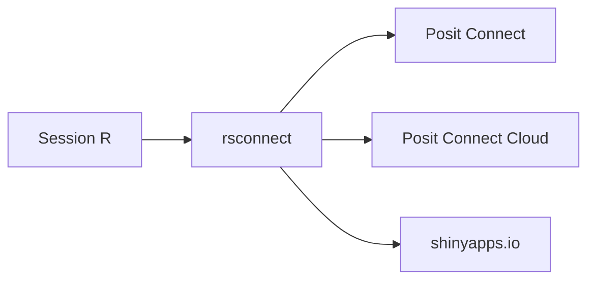

# rstudio/rsconnect

> Paquet R qui publie apps Shiny, documents RMarkdown, Quarto et API Plumber vers Posit Connect ou shinyapps.io.

## Le problème
Déployer une appli ou un rapport R sur un serveur de publication à la main est répétitif et sujet à erreurs.

## Ce que ça fait vraiment
Enregistre un serveur cible (Posit Connect, Connect Cloud ou shinyapps.io) avec une authentification par navigateur, clé d'API ou jeton. Les fonctions `deployApp()` et `deployDoc()` publient ensuite apps, documents et API. L'équivalent Python existe sous le nom rsconnect-python.

## Comment c'est branché
Schéma simplifié d'après la fiche, sans diagramme fourni.



## Essayer
```bash
install.packages("rsconnect")
devtools::install_github("rstudio/rsconnect")
```
Ces commandes s'exécutent dans une session R.

## Coût et pièges
Il faut un compte sur la plateforme cible et R. Posit Connect est un produit d'entreprise ; shinyapps.io demande un jeton. Le catalogue ne déclare aucune licence.

## Ce que ce n'est pas
Pas un serveur : il ne fait que publier vers un service existant. Il ne couvre pas Python.

## Alternatives
- rsconnect-python : l'équivalent à utiliser pour des projets Python.

## Pour toi
À surveiller : pratique si tu publies des apps Shiny ou Quarto pour des métiers, mais lié à l'écosystème Posit et sans licence déclarée.

