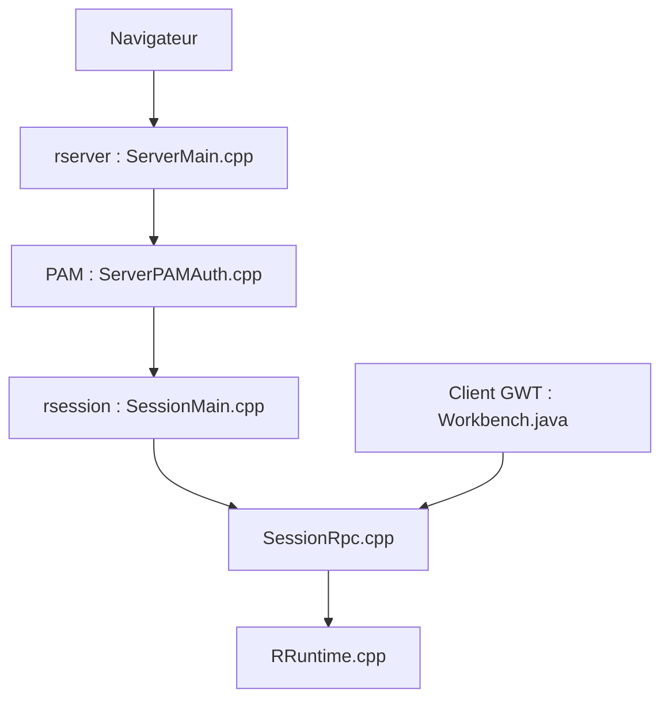

# rstudio/rstudio

> Development environment for the R language, as a desktop application or a multi-user web server.

## The problem
Working in R with console, editor, plots, history and reproducible documents in separate tools wastes time.

## What it actually does
RStudio brings editor, console, plots, terminal, help and packages together in a single workbench, with Quarto and R Markdown. It exists as a desktop app (Electron) or as a browser server with authentication (PAM). Optional AI features (Copilot, Posit Assistant) are offered.

## How it is wired


## Trying it
```bash
# Aucune commande dans le README : voir le site du projet, le fichier INSTALL pour compiler
```

## Cost and gotchas
Free (AGPLv3 according to the README, but license not recognized by GitHub). R must be installed; the optional AI depends on third-party services. Building from source is heavy (C++, Java/GWT, Node).

## What it is not
Not an MLOps platform nor a free managed service: server mode is self-administered. It does not target Python first.

## Alternatives
No alternative cited in the README.

## For you
Adopt if you do statistics or reporting in R: a central, mature tool, maintained by a company.
