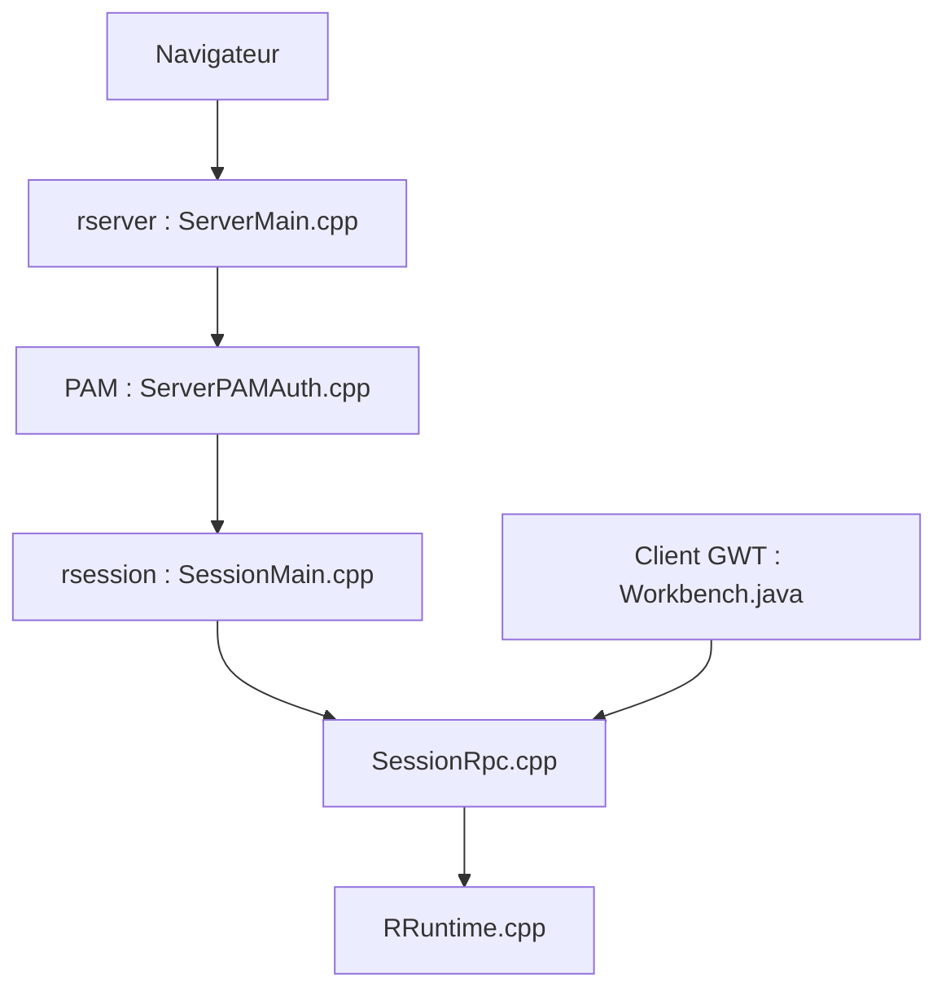

# rstudio/rstudio

> Environnement de développement pour le langage R, en application de bureau ou serveur web multi-utilisateurs.

## Le problème
Travailler en R avec console, éditeur, graphiques, historique et documents reproductibles dans des outils séparés fait perdre du temps.

## Ce que ça fait vraiment
RStudio réunit éditeur, console, graphes, terminal, aide et paquets dans un seul poste de travail, avec Quarto et R Markdown. Il existe en bureau (Electron) ou en serveur navigateur avec authentification (PAM). Des fonctions d'IA optionnelles (Copilot, Posit Assistant) sont proposées.

## Comment c'est branché


## Essayer
```bash
# Aucune commande dans le README : voir le site du projet, le fichier INSTALL pour compiler
```

## Coût et pièges
Gratuit (AGPLv3 selon le README, mais licence non reconnue par GitHub). R doit être installé ; l'IA optionnelle dépend de services tiers. Compilation depuis les sources lourde (C++, Java/GWT, Node).

## Ce que ce n'est pas
Pas une plateforme MLOps ni un service gratuit géré : le mode serveur s'administre soi-même. Il ne vise pas Python en premier.

## Alternatives
Aucune alternative citée dans le README.

## Pour toi
À adopter si tu fais de la statistique ou du reporting en R : outil central et mature, maintenu par une entreprise.

