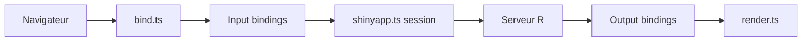

# rstudio/shiny

> R package for building interactive web applications without writing HTML, CSS or JavaScript.

## The problem
Turning an R analysis into an interactive app normally forces you to learn web development.

## What it actually does
A reactive model links inputs and outputs: when an input changes, only the dependent outputs are recomputed. Ready-made widgets, Bootstrap theming customizable with bslib, modules, state bookmarks, asynchronous programming, caching, load testing. An Agent Skill is shipped to help coding agents write idiomatic Shiny. The TypeScript client code connects the browser to the R session.

## How it is wired


## Trying it
```r
install.packages("shiny")
library(shiny)
runExample("06_tabsets")
```

## Cost and gotchas
Free. License present but not identified by GitHub. More than 870 open issues.

## What it is not
Not a Python tool: it is an R package (see the extensions ecosystem for other cases).

## Alternatives
No alternative named in the README.

## For you
Keep an eye on it: very good for model demos on the R side, but of little use if your work stays in Python.
