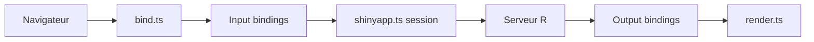

# rstudio/shiny

> Paquet R pour construire des applications web interactives sans écrire de HTML, CSS ou JavaScript.

## Le problème
Transformer une analyse R en appli interactive oblige normalement à apprendre le développement web.

## Ce que ça fait vraiment
Un modèle réactif relie entrées et sorties : quand une entrée change, seules les sorties dépendantes sont recalculées. Widgets prêts à l'emploi, thème Bootstrap personnalisable avec bslib, modules, signets d'état, programmation asynchrone, cache, tests de charge. Un Agent Skill est livré pour aider les agents de code à écrire du Shiny idiomatique. Le code client TypeScript relie le navigateur à la session R.

## Comment c'est branché


## Essayer
```r
install.packages("shiny")
library(shiny)
runExample("06_tabsets")
```

## Coût et pièges
Gratuit. Licence présente mais non identifiée par GitHub. Plus de 870 issues ouvertes.

## Ce que ce n'est pas
Pas un outil Python : c'est un paquet R (voir l'écosystème d'extensions pour d'autres cas).

## Alternatives
Aucune alternative nommée dans le README.

## Pour toi
À surveiller : très bon pour des démos de modèles côté R, mais peu utile si ton travail reste en Python.

